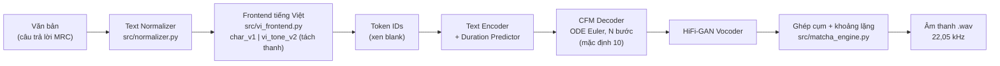

# Phân Hệ Text-to-Speech Tiếng Việt: Matcha-TTS (Flow Matching) & VITS Baseline

Phân hệ tổng hợp tiếng nói của hệ thống **ViMMRC Voice Q&A**: nhận câu trả lời dạng văn bản từ mô hình đọc hiểu (`mrc-model_Huy`) và trả về đường dẫn file âm thanh cho giao diện web (`web-interface_Luong`).

Mô hình mặc định là **Matcha-TTS**, dựa trên Optimal-Transport Conditional Flow Matching (Mehta et al., ICASSP 2024), được huấn luyện cho tiếng Việt. Ba engine khác dùng để đối sánh và dự phòng: VITS (Meta MMS), Edge-TTS và gTTS.

```python
from synthesize import synthesize

audio_path = synthesize("Đáp án B: Hồ Gươm nằm ở trung tâm thủ đô Hà Nội.")   # -> ".../outputs/tts_<timestamp>.wav"
```

---

## 1. Tính Năng Chính

| Tính năng | Mô tả |
|---|---|
| **Mô hình Flow Matching cục bộ** | Matcha-TTS chạy trên CPU, không cần mạng: 10 bước ODE, **RTF 0,5 – 0,6**, nhanh hơn thời gian thực ([mục 7](#7-đánh-giá--benchmark)) |
| **Biểu diễn thanh điệu tách rời** | Frontend `vi_tone_v2` tách 6 thanh thành token riêng ở cuối âm tiết (`hồ` → `h ô 2`), dùng chung cho mọi nguyên âm ([chi tiết](docs/matcha-architecture.md#41-tách-thanh-điệu-tone-decoupling-frontend-vi_tone_v2)) |
| **Chuẩn hóa ngôn ngữ ViMMRC** | Nhãn trắc nghiệm `(B)`, `B.`, `**Đáp án:** (B)` → `Đáp án B:`; ngày tháng, số nguyên và số thập phân, %, tiền tệ, đơn vị đo; đánh vần chữ viết tắt (`B` → `bê`) |
| **Ngắt nghỉ tự nhiên** | Sinh theo từng cụm dấu câu, chèn khoảng lặng 0,15 s / 0,25 s / 0,4 s; cắt nhiễu và chuẩn hóa âm lượng |
| **Đa người nói** | Checkpoint VIVOS có 65 giọng; giọng nam và nữ mặc định được chọn theo CER thấp nhất |
| **Đa engine** | `matcha` (mặc định), `vits` (baseline MMS), `edge` (cloud neural), `gtts` (dự phòng, tự kích hoạt khi engine khác lỗi) |
| **Đánh giá định lượng** | MCD-DTW, F0 RMSE, log-F0 RMSE, CER (ASR PhoWhisper), RTF so với giọng người thật |

---

## 2. Kiến Trúc Xử Lý



1. **Normalizer** viết số, ngày tháng, đơn vị thành chữ và chuẩn hóa nhãn đáp án:
   `**Đáp án:** (B) … ngày 07/05/1954.` → `Đáp án B: … ngày bảy tháng năm năm một nghìn chín trăm năm mươi tư.`
2. **Frontend** chọn cách token hóa theo metadata của checkpoint. Với `vi_tone_v2`:
   `Đáp án B: Hồ Gươm` → `đ a p 1 · a n 1 · b ê 0 · , · h ô 2 · g ư ơ m 0`.
3. **Text encoder** (Transformer, RoPE) cho ra $\mu$ của từng token. **Duration predictor** quyết định số khung mel cho mỗi token.
4. **Decoder CFM** giải ODE $dx/dt = v_\theta(x, t \mid \mu)$ từ nhiễu Gauss tới mel-spectrogram, theo đường vận chuyển tối ưu thẳng.
5. **HiFi-GAN** chuyển mel thành dạng sóng. Engine sinh theo từng cụm dấu câu rồi ghép lại với khoảng lặng.

Phân tích toán học (CFM, OT path, $\mathcal{L}_{\text{CFM}}$, so sánh với Diffusion và VITS): [`docs/matcha-architecture.md`](docs/matcha-architecture.md).

---

## 3. Cấu Trúc Thư Mục

```text
text-to-speech_Duy/
├── synthesize.py                 # ENTRYPOINT DUY NHẤT: synthesize(text, ...) -> str (đường dẫn audio) + CLI
├── src/                          # Gói mã nguồn lõi
│   ├── normalizer.py             #   Chuẩn hóa văn bản tiếng Việt / định dạng đáp án ViMMRC
│   ├── vi_frontend.py            #   Token hóa: char_v1, vi_tone_v2 (tách thanh điệu); dùng chung với notebook
│   ├── matcha_engine.py          #   Suy luận Matcha-TTS: nạp checkpoint, ngắt cụm, vocoder, hậu xử lý
│   ├── tts_engine.py             #   Giao diện BaseTTSEngine + MatchaEngine, VITSEngine, EdgeTTSEngine, GTTSEngine
│   ├── vits_decomposed.py        #   VITS MMS: suy luận + bóc tách tensor trung gian (phục vụ nghiên cứu)
│   ├── evaluator.py              #   Chỉ số đánh giá: MCD-DTW, F0 / log-F0 RMSE (pYIN), CER, RTF
│   └── vivos_preprocessor.py     #   Đọc VIVOS, xuất manifest JSONL
├── scripts/                      # Công cụ phụ trợ (chạy được từ bất kỳ thư mục nào)
│   ├── setup_matcha.py           #   Cài mã nguồn Matcha-TTS (commit cố định) + Monotonic Alignment Search bản numba
│   ├── benchmark.py              #   Benchmark các engine so với giọng người thật InfoRe1
│   ├── audition_speakers.py      #   Chấm CER từng giọng / từng checkpoint
│   └── sync_notebook_frontend.py #   Đồng bộ src/vi_frontend.py vào notebook huấn luyện
├── notebooks/
│   ├── 01_tts_exploration.ipynb  #   Khảo sát VITS: trực quan hóa tensor, phổ, RTF
│   └── 02_train_matcha_colab.ipynb  # Huấn luyện Matcha-TTS trên Colab: dữ liệu → train → chọn CER → fine-tune HiFi-GAN
├── tests/
│   ├── test_tts.py               #   Kiểm thử normalizer và 4 engine qua entrypoint synthesize()
│   └── test_vi_frontend.py       #   Kiểm thử frontend + đồng bộ với notebook
├── docs/
│   ├── matcha-architecture.md    #   Lý thuyết Conditional Flow Matching & kiến trúc Matcha-TTS
│   ├── vits-architecture.md      #   Lý thuyết VITS (baseline)
│   └── research-plan.md          #   Phương pháp luận, thiết kế thực nghiệm, kết quả
├── checkpoints/                  # Trọng số mô hình (không commit, xem mục 4.2)
├── outputs/                      # Audio sinh ra (không commit)
├── Matcha-TTS/                   # Mã nguồn Matcha-TTS gốc (không commit, tạo bởi scripts/setup_matcha.py)
├── requirements.txt
└── .gitignore
```

---

## 4. Cài Đặt

### 4.1. Thư viện và mã nguồn Matcha-TTS

```bash
cd text-to-speech_Duy
pip install -r requirements.txt
python scripts/setup_matcha.py      # clone Matcha-TTS (commit bd4d90d) + vá Monotonic Alignment Search
```

Engine `vits` tự tải `facebook/mms-tts-vie` từ Hugging Face ở lần chạy đầu. Engine `edge` và `gtts` cần Internet.

### 4.2. Trọng số mô hình (`checkpoints/`)

| File | Nguồn | Bắt buộc |
|---|---|---|
| `matcha_vi.pt` + `vivos_meta.json` | Checkpoint VIVOS (65 giọng, frontend `char_v1`). Lấy từ thư mục Drive huấn luyện của phân hệ hoặc từ người phụ trách (Duy). `vivos_meta.json` đã có trong repo | Có, nếu chưa có bản mới |
| `matcha_vi_v2.pt` + `matcha_vi_v2_hifigan.pt` | Kết quả của `notebooks/02_train_matcha_colab.ipynb`: tải từ `MyDrive/Colab Notebooks/TTS/export/` | Không (được ưu tiên nếu có) |
| `hifigan_univ_v1` | HiFi-GAN Universal, **tự tải** về ở lần chạy đầu | Tự động |

Thứ tự chọn checkpoint: `matcha_vi_v2.pt` → `matcha_vi.pt` → `best_model.pt`. Vocoder đi kèm (`<tên checkpoint>_hifigan.pt`) được ưu tiên hơn bản Universal. Nếu không có checkpoint Matcha nào, engine tự chuyển sang VITS.

---

## 5. Sử Dụng

### 5.1. Python API (tích hợp với các phân hệ khác)

```python
from synthesize import synthesize

# Mặc định: Matcha-TTS, giọng nữ, chuẩn hóa văn bản bật
path = synthesize("**Đáp án:** (B) Chiến thắng Điện Biên Phủ ngày 07/05/1954.")

# Chọn engine / giọng / tốc độ
path = synthesize("Xin chào.", output_path="outputs/nam.wav", engine="matcha", voice="nam", rate="-10%")
path = synthesize("Xin chào.", engine="matcha", speaker_id=43)                 # giọng VIVOS cụ thể (0 - 64)
path = synthesize("Xin chào.", engine="edge", voice="vi-VN-NamMinhNeural")    # -> .mp3
```

| Tham số | Mặc định | Ý nghĩa |
|---|---|---|
| `text` | (bắt buộc) | Văn bản tiếng Việt |
| `output_path` | `outputs/tts_<ms>.wav` | File đầu ra (`.wav` cho matcha/vits, `.mp3` cho edge/gtts) |
| `voice` | `vi-VN-HoaiMyNeural` | `nu` / `nam` / tên giọng Edge. Matcha chọn giọng VIVOS mặc định theo giới tính |
| `engine` | `matcha` | `matcha`, `vits`, `edge`, `gtts` |
| `checkpoint_path` | tự chọn | File `.pt` của Matcha-TTS |
| `normalize` | `True` | Chuẩn hóa số, ngày tháng, nhãn đáp án |
| `rate` | `+0%` | Tốc độ đọc tương đối (matcha, edge) |
| `pitch` | `+0Hz` | Cao độ (edge) |
| `speaker_id` | `None` | Chỉ số giọng Matcha đa giọng; ưu tiên hơn `voice` |

Engine được khởi tạo một lần và dùng lại giữa các lần gọi, nên chỉ lần gọi đầu mất thời gian nạp mô hình. Nếu engine được chọn bị lỗi, hàm tự chuyển sang gTTS và trả về file `.mp3`.

### 5.2. Dòng lệnh

```bash
python synthesize.py -t "Đáp án B: Hồ Gươm nằm ở Hà Nội."                  # Matcha, giọng nữ mặc định
python synthesize.py -t "Xin chào các bạn." -v nam -o outputs/nam.wav      # giọng nam mặc định
python synthesize.py -t "Xin chào các bạn." -s 43                          # --speaker-id: giọng VIVOS số 43
python synthesize.py -t "Xin chào các bạn." --rate -10%                    # chậm hơn 10%
python synthesize.py -t "Xin chào các bạn." -e edge -v vi-VN-NamMinhNeural # Edge-TTS
python synthesize.py -t "Xin chào các bạn." -c checkpoints/matcha_vi_v2.pt # chỉ định checkpoint
```

### 5.3. Chọn giọng

Giọng VIVOS mặc định: nữ `VIVOSSPK25` (id 43), nam `VIVOSSPK12` (id 30). Cả hai có CER 0% trong lần chấm 65 giọng. Để chấm lại hoặc thử các giọng khác:

```bash
python scripts/audition_speakers.py                    # chấm cả 65 giọng, kết quả ở outputs/audition/
python scripts/audition_speakers.py --speakers 30 43   # chỉ vài giọng
```

---

## 6. Huấn Luyện (Google Colab)

[`notebooks/02_train_matcha_colab.ipynb`](notebooks/02_train_matcha_colab.ipynb) chạy được trên Colab miễn phí (GPU T4). Mọi trạng thái lưu ở `MyDrive/Colab Notebooks/TTS/{data, training, snapshots, samples, export}`, nên bị ngắt kết nối thì chỉ cần **Run all** để chạy tiếp.

1. Dữ liệu InfoRe1 (25 giờ, 1 giọng): resample 22,05 kHz, cắt im lặng, chuẩn hóa RMS, tính mel.
2. Khởi tạo từ Matcha LJSpeech, train 100k step (frontend `vi_tone_v2`), lưu snapshot mỗi 10k step.
3. Chọn snapshot bằng CER (PhoWhisper), sau đó fine-tune HiFi-GAN trên mel teacher-forced.
4. Tải 2 file trong `export/` về `checkpoints/`.

Khi sửa `src/vi_frontend.py`, chạy `python scripts/sync_notebook_frontend.py` để cập nhật bản sao trong notebook.

---

## 7. Đánh Giá & Benchmark

```bash
python scripts/benchmark.py                 # 10 câu, đủ chỉ số (lần đầu tải câu tham chiếu + PhoWhisper)
python scripts/benchmark.py -n 5 --no-cer   # nhanh hơn
```

Tham chiếu là **giọng người thật**: 10 câu thu âm InfoRe1, giọng nữ. Các engine đọc đúng văn bản của từng câu. Báo cáo được ghi ra `outputs/benchmark/benchmark_report.md`.

Kết quả ngày 10/10/2026: 10 câu, CPU, checkpoint VIVOS (`matcha_vi.pt`, giọng nữ `VIVOSSPK25`, 10 bước ODE).

| Mô hình | MCD (dB) ↓ | F0 RMSE (Hz) ↓ | log-F0 RMSE (bán cung) ↓ | CER ↓ | RTF (CPU) ↓ | Ghi chú |
|---|:---:|:---:|:---:|:---:|:---:|---|
| Giọng người thật (InfoRe1) | – | – | – | 0,7% | – | Tham chiếu; CER trần của ASR |
| **Matcha-TTS (tự huấn luyện)** | 5,35 | 70,4 | **2,86** | **1,9%** | 0,52 | OT-CFM, cục bộ |
| VITS MMS (pretrained) | **4,45** | 84,1 | 4,31 | 4,3% | 0,38 | End-to-end VAE, cục bộ, **giọng nam** |
| Edge-TTS HoaiMy | 4,63 | **48,3** | 2,69 | 1,0% | 0,13 | Cloud; RTF gồm độ trễ mạng |

**Nhận xét:**
- **Độ rõ (CER):** Matcha rõ nhất trong hai mô hình cục bộ, ít lỗi hơn VITS khoảng 2 lần. Matcha lấy mẫu từ nhiễu ngẫu nhiên nên CER dao động giữa các lần chạy (0,8% – 1,9% qua 3 lần đo), luôn ngang Edge-TTS và sát mức trần 0,7% của ASR.
- **Thanh điệu (log-F0 RMSE):** đường cao độ của Matcha gần Edge-TTS (2,86 so với 2,69 bán cung) và tốt hơn rõ rệt so với VITS (4,31).
- **MCD và F0 RMSE (Hz)** bao gồm cả khác biệt về **chất giọng**, vì tham chiếu là một người nói khác. VITS là giọng nam nên F0 RMSE tính bằng Hz cao. MCD của Matcha cao nhất, phù hợp với chẩn đoán dữ liệu VIVOS có nhiễu và vocoder chưa fine-tune; đây là điều mà pipeline huấn luyện mới nhắm tới.
- **Tốc độ:** Matcha đạt RTF 0,52 trên CPU, tức nhanh hơn thời gian thực khoảng 2 lần mà không cần mạng.

Định nghĩa chỉ số và thiết lập thực nghiệm: [`docs/research-plan.md`](docs/research-plan.md#3-hệ-thống-tiêu-chí-đánh-giá).

---

## 8. Kiểm Thử

```bash
python -m pytest tests/ -v          # toàn bộ (edge, gtts cần Internet; vits tải mô hình ở lần đầu)
python tests/test_tts.py            # chạy tuần tự, in chi tiết từng bước
python src/evaluator.py             # tự kiểm tra các hàm đo trên tín hiệu tổng hợp
```

| Bộ kiểm thử | Nội dung |
|---|---|
| `test_tts.py::test_normalizer` | Chuẩn hóa đáp án, ngày tháng, số, đơn vị |
| `test_tts.py::test_vits_engine`, `test_matcha_engine`, `test_edge_tts`, `test_gtts_fallback` | Từng engine qua `synthesize()` sinh được file audio |
| `test_tts.py::test_sample_answers` | Câu trả lời ViMMRC mẫu (Markdown, nhãn đáp án, số) |
| `test_vi_frontend.py` | Tách thanh điệu, dấu câu, chữ viết tắt, blank; notebook chứa đúng bản sao frontend |

---

## 9. Tài Liệu Nghiên Cứu & Báo Cáo Kỹ Thuật

Toàn bộ tài liệu được sắp xếp theo thứ tự đọc chuẩn tại thư mục [`docs/`](docs/README.md):
- [`docs/1_tong_quan_va_khac_biet_cai_tien.md`](docs/1_tong_quan_va_khac_biet_cai_tien.md): Đặt vấn đề, vị trí TTS & 4 đóng góp kỹ thuật cốt lõi so với các bài báo hiện nay.
- [`docs/2_co_so_toan_va_kien_truc_matcha.md`](docs/2_co_so_toan_va_kien_truc_matcha.md): Toán học Conditional Flow Matching (OT-CFM), Euler ODE solver & kiến trúc mạng Matcha-TTS.
- [`docs/3_thich_nghi_tieng_viet_tone_decoupling.md`](docs/3_thich_nghi_tieng_viet_tone_decoupling.md): Kỹ thuật tách thanh điệu (Tone Decoupling, `vi_tone_v2`), chuẩn hóa văn bản & hậu xử lý.
- [`docs/4_quy_trinh_huan_luyen_va_vocoder_hifigan.md`](docs/4_quy_trinh_huan_luyen_va_vocoder_hifigan.md): Pipeline Colab, chọn snapshot bằng PhoWhisper CER & Teacher-Forced Vocoder Fine-Tuning.
- [`docs/5_mo_hinh_doi_sanh_vits_baseline.md`](docs/5_mo_hinh_doi_sanh_vits_baseline.md): Bóc tách mô hình nền VITS MMS và thực nghiệm so sánh định lượng.
- Quy ước chung của dự án: [`../CONVENTIONS.md`](../CONVENTIONS.md).
