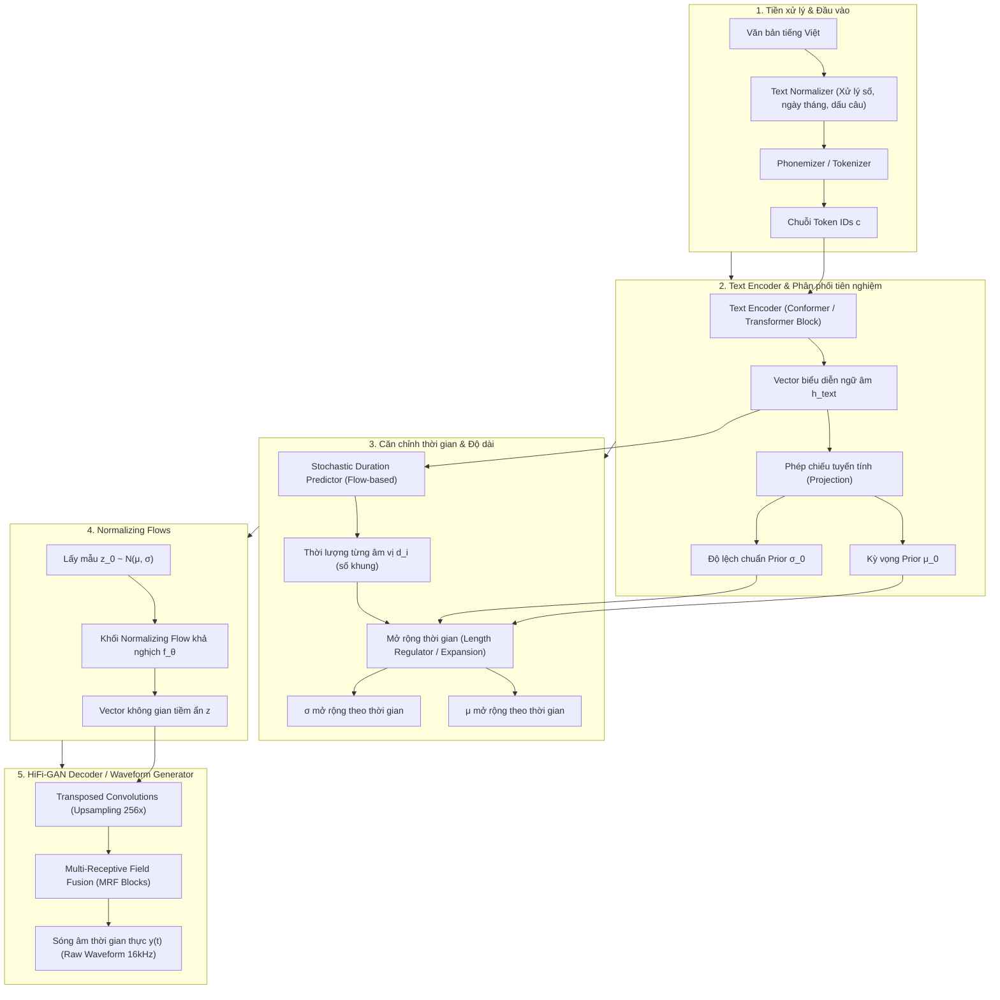

# Kiến Trúc Mô Hình VITS (Variational Inference for End-to-End Text-to-Speech)

Tài liệu này phân tích chi tiết nguyên lý toán học, cấu trúc các khối thành phần và quy trình xử lý bên trong mô hình **VITS** — kiến trúc học sâu tiên tiến nhất hiện nay cho bài toán tổng hợp tiếng nói (Text-to-Speech).

---

## 1. Đặt Vấn Đề & Bối Cảnh Lịch Sử Của TTS

Tổng hợp tiếng nói từ văn bản là bài toán ánh xạ từ một chuỗi ký hiệu rời rạc $X = [x_1, x_2, \dots, x_N]$ (văn bản/âm vị) sang một chuỗi sóng âm thanh liên tục $Y = [y_1, y_2, \dots, y_T]$ (với $T \gg N$, thường $16.000$ đến $22.050$ điểm mẫu mỗi giây).

### Thách thức chính:
1. **Quan hệ một-nhiều (One-to-many mapping):** Cùng một câu văn, con người có thể phát âm với vô số biến thể về ngữ điệu, cao độ (pitch), tốc độ (rhythm) và cảm xúc khác nhau.
2. **Căn chỉnh thời gian (Alignment problem):** Văn bản không chứa thông tin về việc mỗi từ/âm vị sẽ kéo dài bao nhiêu mili-giây trong âm thanh.

### Các giai đoạn tiến hóa:
- **Hệ thống ghép nối (Concatenative TTS):** Ghép các đoạn mẫu âm thu sẵn từ diễn viên lồng tiếng. Giọng nói rõ ràng nhưng thiếu biểu cảm, chuyển tiếp giữa các âm không tự nhiên.
- **Hệ thống 2 giai đoạn (Two-stage Deep Learning):**
  - *Giai đoạn 1 (Acoustic Model - Tacotron 2, FastSpeech 2):* Dự đoán phổ âm thanh trung gian (Mel-spectrogram) từ văn bản.
  - *Giai đoạn 2 (Neural Vocoder - WaveNet, HiFi-GAN):* Sinh sóng âm (waveform) từ Mel-spectrogram.
  - *Nhược điểm:* **Lỗi tích lũy (Mismatch error)**. Do Mel-spectrogram do mô hình giai đoạn 1 sinh ra luôn có sai số so với Mel thực tế, khiến Vocoder ở giai đoạn 2 dễ tạo ra tạp âm kim loại, méo tiếng.
- **Hệ thống End-to-End thực sự (VITS - ICML 2021):**
  - Loại bỏ hoàn toàn biểu diễn Mel-spectrogram trung gian trong pha sinh âm thanh.
  - Ánh xạ trực tiếp từ Văn bản $\rightarrow$ Sóng âm thông qua suy diễn biến phân (**Variational Inference**), mạng dòng chuẩn hóa (**Normalizing Flows**) và huấn luyện đối nghịch (**GAN**).

---

## 2. Sơ Đồ Kiến Trúc Tổng Thể Của VITS

---

## 3. Phân Rã Chi Tiết 5 Thành Phần Cốt Lõi

### Khối 1: Text Encoder & Phân phối tiên nghiệm (Prior Distribution)
- **Đầu vào:** Chuỗi token văn bản hoặc âm vị $c = [c_1, c_2, \dots, c_N]$.
- **Kiến trúc:** Dựa trên Transformer kết hợp Depthwise Separable Convolutions:
  - Lớp Multi-Head Self-Attention để mô hình hóa mối tương quan ngữ cảnh xa giữa các từ trong câu.
  - Lớp Feed-Forward dạng Convolution để nắm bắt thông tin phát âm cục bộ.
- **Đầu ra:** Vector đặc trưng ngữ âm $h_{text} \in \mathbb{R}^{d \times N}$.
- **Cơ chế suy diễn biến phân:** $h_{text}$ được chiếu qua 2 lớp tuyến tính riêng biệt để tạo ra:
  $$\mu_0 = \text{Linear}_\mu(h_{text}), \quad \log \sigma_0 = \text{Linear}_\sigma(h_{text})$$
  Đây là tham số của phân phối tiên nghiệm trong không gian tiềm ẩn: $p(z | c) = \mathcal{N}(z; \mu_0, \sigma_0^2 I)$.

---

### Khối 2: Căn chỉnh & Dự đoán thời lượng (Alignment & Duration)

Trong bài toán TTS, một từ có thể kéo dài $0.1$ giây hoặc $0.5$ giây. VITS giải quyết bài toán này mà không cần gán nhãn thời gian từ trước thông qua 2 cơ chế:

#### a. Monotonic Alignment Search (MAS) - Dùng trong quá trình Huấn luyện (Training):
- Cho trước chuỗi đặc trưng âm thanh thực tế $z_{audio}$ độ dài $T$ và biểu diễn văn bản độ dài $N$.
- MAS sử dụng thuật toán **Quy hoạch động (Dynamic Programming)** để tìm đường đi đơn điệu tối ưu $A: \{1, \dots, T\} \to \{1, \dots, N\}$ nhằm tối đa hóa xác suất hợp lý:
  $$\hat{A} = \arg\max_A \sum_{t=1}^T \log p(z_t | c_{A(t)})$$
- Ràng buộc của MAS:
  - Khung đầu âm thanh phải ứng với token đầu văn bản: $A(1) = 1$.
  - Khung cuối âm thanh phải ứng với token cuối văn bản: $A(T) = N$.
  - Đơn điệu không lùi: $A(t) \in \{A(t-1), A(t-1) + 1\}$ (không được nhảy cóc lùi lại).

#### b. Stochastic Duration Predictor (SDP) - Dùng trong quá trình Suy luận (Inference):
- Mô hình hóa thời lượng $d_i$ của mỗi âm vị dưới dạng một biến ngẫu nhiên liên tục thông qua mạng dòng chuẩn hóa (**Normalizing Flow**).
- Cho phép người dùng điều chỉnh tham số:
  - `speaking_rate`: Tỷ lệ co/giãn độ dài âm vị để điều chỉnh tốc độ nói nhanh hay chậm.
  - `noise_scale_duration`: Biên độ nhiễu ngẫu nhiên, giúp tạo ngữ điệu và nhịp thở tự nhiên khác nhau mỗi lần sinh câu nói.

---

### Khối 3: Normalizing Flows (Biến đổi không gian tiềm ẩn)
- **Vấn đề:** Một phân phối Gauss chuẩn đơn giản $\mathcal{N}(\mu_0, \sigma_0^2)$ không đủ năng lực biểu diễn các đặc trưng âm học phức tạp (như độ rung thanh quản, sắc thái âm vực).
- **Giải pháp:** Sử dụng chuỗi biến đổi khả nghịch $f_\theta = f_1 \circ f_2 \circ \dots \circ f_K$ (Normalizing Flow) với các lớp Affine Coupling Layer và kiến trúc WaveNet Residual:
  $$z = f_\theta(z_0), \quad z_0 \sim \mathcal{N}(\mu_0, \sigma_0^2)$$
- Khối Flow này giúp "uốn cong" không gian tiềm ẩn, biến phân phối đơn giản thành phân phối giàu chi tiết âm học hơn trước khi chuyển sang bộ sinh sóng âm.

---

### Khối 4: HiFi-GAN Decoder / Waveform Generator
- **Đầu vào:** Vector tiềm ẩn $z \in \mathbb{R}^{d \times T_{frames}}$ (trong đó $T_{frames}$ là số lượng khung sau khi đã giãn theo thời gian thực).
- **Kiến trúc:** Dựa trên generator của **HiFi-GAN**:
  1. **Transposed Convolutions (Upsampling):** Mạng thực hiện nâng tần số qua các tỉ lệ $[8, 8, 2, 2]$:
     $$\text{Tổng hệ số phóng đại} = 8 \times 8 \times 2 \times 2 = 256$$
     Nếu tốc độ khung hình là $\approx 62.5\text{ frames/s}$, sau khi qua khối này ta thu được âm thanh với tần số lấy mẫu chính xác là:
     $$62.5 \times 256 = 16.000\text{ mẫu/giây (16 kHz)}$$
  2. **Multi-Receptive Field Fusion (MRF):**
     - Âm thanh tự nhiên chứa cả tần số cơ bản (bước sóng dài) và các họa âm (bước sóng ngắn).
     - MRF chạy song song các khối tích chập phần dư (Residual blocks) với các kích thước bộ lọc (kernel sizes: $3, 7, 11$) và hệ số giãn nở (dilations: $1, 3, 5$) khác nhau.
     - Sau đó cộng tổng hợp các đặc trưng lại với nhau để vừa giữ được độ chắc của âm trầm vừa tái tạo sắc nét các âm gió, âm xát.
- **Đầu ra:** Mảng 1 chiều chứa các giá trị biên độ sóng âm thực: $y(t) \in [-1.0, 1.0]$.

---

### Khối 5: Discriminators & Huấn Luyện Đối Nghịch (GAN)

Trong quá trình huấn luyện, VITS sử dụng 2 loại bộ phân biệt (Discriminator) để buộc Generator phải tạo ra âm thanh không thể phân biệt được với giọng người thật:

1. **Multi-Period Discriminator (MPD):**
   - Chia tín hiệu âm thanh 1D thành các ma trận 2D theo các chu kỳ nguyên tố khác nhau (ví dụ chu kỳ $p \in [2, 3, 5, 7, 11]$).
   - Giúp kiểm tra và loại bỏ các lỗi sai lệch về chu kỳ dao động của dây thanh âm (pitch period).
2. **Multi-Scale Discriminator (MSD):**
   - Kiểm tra tín hiệu âm thanh ở nhiều tỷ lệ lấy mẫu khác nhau (nguyên bản, hạ mẫu 2x, hạ mẫu 4x).
   - Đảm bảo tính liên tục của cấu trúc âm thanh từ cấp độ toàn cục đến vi mô.

---

## 4. Các Hàm Mất Mát (Loss Functions)

Tổng hàm mất mát của VITS được tối ưu hóa đồng thời gồm 5 thành phần:

$$\mathcal{L}_{total} = \mathcal{L}_{recon} + \mathcal{L}_{kl} + \mathcal{L}_{dur} + \mathcal{L}_{adv}(G) + \mathcal{L}_{fm}$$

1. **Reconstruction Loss ($\mathcal{L}_{recon}$):** Đo sai số $L_1$ giữa Mel-spectrogram của âm thanh sinh ra và âm thanh thực tế.
2. **KL Divergence Loss ($\mathcal{L}_{kl}$):** Kéo phân phối hậu nghiệm từ âm thanh $q(z|y)$ và phân phối tiên nghiệm từ văn bản $p(z|c)$ lại gần nhau.
3. **Duration Loss ($\mathcal{L}_{dur}$):** Sai số âm log-likelihood giữa thời lượng dự đoán bởi SDP và thời lượng thực tế tìm được từ MAS.
4. **Adversarial Loss ($\mathcal{L}_{adv}$):** Đánh giá mức độ đánh lừa Discriminator theo công thức Least-Squares GAN.
5. **Feature Matching Loss ($\mathcal{L}_{fm}$):** Đo độ tương đồng giữa các đặc trưng ở các tầng ẩn trung gian của Discriminator khi nhận âm thanh thật và âm thanh giả.

---

## 5. Bảng So Sánh VITS Với Các Mô Hình Tiền Nhiệm

| Tiêu chí | Tacotron 2 (2018) | FastSpeech 2 (2020) | VITS (2021) |
|---|---|---|---|
| **Cấu trúc pipeline** | 2 giai đoạn (Acoustic + Vocoder) | 2 giai đoạn (Acoustic + Vocoder) | **1 giai đoạn (Fully End-to-End)** |
| **Tốc độ sinh (Inference)** | Tuần tự tự hồi quy (Autoregressive - Chậm) | Không tự hồi quy (Non-autoregressive - Nhanh) | **Không tự hồi quy (Song song - Rất nhanh)** |
| **Bộ căn chỉnh (Aligner)** | Attention Mechanism (dễ lặp từ, nuốt từ) | Cần công cụ bên ngoài (Montreal Forced Aligner) | **Tự học nội bộ (Monotonic Alignment Search)** |
| **Độ tự nhiên (MOS)** | Tốt nhưng đôi khi lỗi nhịp | Khá tốt, âm thanh hơi cứng | **Rất cao (tương đương giọng người thật)** |
| **Lỗi ghép nối trung gian** | Có (Mel mismatch) | Có (Mel mismatch) | **Hoàn toàn không có** |

---

## 6. Tổng Kết

VITS là một trong những thành tựu đột phá nhất của bài toán tổng hợp tiếng nói. Bằng cách kết hợp linh hoạt giữa:
- **Biến phân (VAE):** Cho phép mô hình hóa các biến thể ngẫu nhiên của giọng nói.
- **Normalizing Flows:** Làm giàu không gian phân phối tiềm ẩn.
- **Quy hoạch động (MAS):** Tự động giải quyết bài toán gióng hàng thời gian.
- **Mạng đối nghịch (GAN):** Tái tạo sóng âm sắc nét, tự nhiên ở tốc độ cao.

Mô hình loại bỏ hoàn toàn các điểm nghẽn của các thế hệ TTS cũ, trở thành kiến trúc nền tảng được Meta (dự án MMS), Microsoft và các phòng nghiên cứu hàng đầu thế giới áp dụng rộng rãi.
