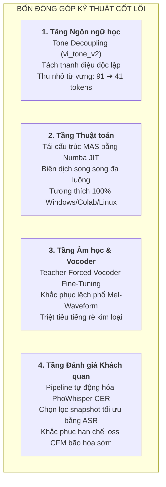

# Tài Liệu 1: Tổng Quan Nghiên Cứu, Khác Biệt & Các Điểm Cải Tiến Cốt Lõi

> **Thứ tự đọc:** `1 / 5` — Đọc tài liệu này đầu tiên để nắm được bài toán, bối cảnh công nghệ TTS, và trả lời câu hỏi cốt lõi: *"Dự án này khác gì các bài báo hiện nay, cải tiến ở điểm nào hay chỉ lấy trên mạng về ghép vào?"*

---

## 1. Đặt Vấn Đề Khoa Học & Bối Cảnh Dự Án

### 1.1. Vị trí của phân hệ TTS trong hệ thống ViMMRC Voice Q&A
Dự án **ViMMRC Voice Q&A** là hệ thống hỏi đáp tiếng Việt thông minh đa phương thức, cho phép người dùng giao tiếp hai chiều bằng giọng nói:
```
[Người dùng nói] 
       │ (audio)
       ▼
 [Module 1: STT (Faster-Whisper)] ──> [Văn bản câu hỏi]
                                             │
                                             ▼
                               [Module 2: BM25 Retrieval] ──> [Đoạn văn liên quan]
                                             │
                                             ▼
                               [Module 3: MRC Reader]     ──> [Văn bản câu trả lời]
                                             │
                                             ▼
                               [Module 4: Phân hệ TTS]    ──> [File âm thanh đọc to]
                                             │ (audio)
                                             ▼
                                     [Người dùng nghe]
```
Trong chuỗi mắt xích trên, **phân hệ Text-to-Speech (TTS)** giữ vai trò đầu ra cuối cùng: chuyển đổi câu trả lời dạng văn bản do mô hình MRC trích xuất thành giọng nói tự nhiên, rõ ràng và chuẩn thanh điệu tiếng Việt.

### 1.2. Thách thức đặc thù của tiếng Việt đối với các mô hình TTS
1. **Ngôn ngữ đơn lập và có 6 thanh điệu phức tạp**: Tiếng Việt gồm 6 thanh (*ngang, sắc, huyền, hỏi, ngã, nặng*). Đường cong cao độ ($F_0$) của âm tiết quyết định hoàn toàn ngữ nghĩa của từ. Một mô hình đọc sai thanh điệu sẽ dẫn đến hiểu sai hoàn toàn nội dung.
2. **Dữ liệu tiếng Việt khan hiếm và chất lượng không đồng đều**: Các tập dữ liệu tiếng Việt công khai (như VIVOS) chủ yếu phục vụ bài toán nhận dạng giọng nói (ASR), có nhiều tạp âm nền (−37 dBFS) và thời lượng mỗi người nói rất ngắn (~14 phút).
3. **Môi trường triển khai hạn chế tài nguyên**: Hệ thống cần chạy suy luận mượt mà trên môi trường CPU của máy tính thông thường (hoặc máy chủ không GPU đắt tiền) với thời gian thực (Real-Time Factor $\text{RTF} < 1.0$).

---

## 2. Bức Tranh Công Nghệ TTS Thế Giới (SOTA)

Tổng hợp giọng nói là bài toán ánh xạ chuỗi văn bản $x_{1:N}$ sang dạng sóng âm thanh $y(t)$. Do một câu văn bản có vô số cách đọc khác nhau (về tốc độ, cảm xúc, cao độ), mô hình âm học bắt buộc phải học **phân phối xác suất** $p(y \mid x)$ chứ không thể chỉ là hồi quy đơn thuần.

| Thế hệ | Công nghệ tiêu biểu | Cơ chế sinh | Ưu điểm | Nhược điểm lớn |
| :--- | :--- | :--- | :--- | :--- |
| **Giai đoạn 1** | Tacotron 2, FastSpeech 2 | Hồi quy L1/L2 tất định | Nhanh (1 bước) | Phổ mel bị nhòe (oversmoothing), giọng đều đều, thiếu tự nhiên |
| **Giai đoạn 2** | **VITS** (ICML 2021) | VAE + Normalizing Flow + GAN | End-to-end, sinh trong 1 bước lan truyền | Huấn luyện đối kháng (GAN) cực kỳ bất ổn, dễ sụp mode, tốn VRAM lớn |
| **Giai đoạn 3** | **Grad-TTS** (ICML 2021) | Diffusion Probabilistic (SDE) | Giọng nói tự nhiên, phong phú | Quỹ đạo khuếch tán cong, cần **50–1000 bước** lấy mẫu, rất chậm trên CPU |
| **Giai đoạn 4 (2024)** | **Matcha-TTS** (ICASSP 2024) | **Optimal-Transport Conditional Flow Matching (OT-CFM)** | **Quỹ đạo sinh là đường thẳng**, chỉ cần **4–10 bước ODE**, huấn luyện hồi quy thuần cực kỳ ổn định | Hai giai đoạn (cần Vocoder để tái tạo sóng âm từ phổ Mel) |

Nhận thấy tiềm năng vượt trội của công nghệ Flow Matching thế hệ mới (vừa tự nhiên như Diffusion, vừa nhanh và ổn định hơn GAN), đề tài đã lựa chọn **Matcha-TTS** làm kiến trúc âm học mục tiêu.

---

## 3. Trả Lời Câu Hỏi Cốt Lõi: Khác Biệt & Cải Tiến Gì So Với Các Bài Báo Hiện Nay?

> *"Phần huấn luyện này khác gì so với những bài báo và công nghệ hiện nay? Khác ở điểm nào và có cải tiến gì không, hay chỉ lấy trên mạng về rồi ghép vào?"*

Đây là câu hỏi phản biện then chốt. Câu trả lời là: **Hoàn toàn KHÔNG THỂ "lấy trên mạng về ghép vào"**, bởi vì:
- Bài báo gốc Matcha-TTS (*Mehta et al., ICASSP 2024*) **chỉ được thiết kế và thực nghiệm duy nhất cho tiếng Anh** (bộ dữ liệu LJSpeech). Họ **hoàn toàn không hỗ trợ tiếng Việt**, không có token thanh điệu, và không có trọng số cho tiếng Việt.
- Mã nguồn Monotonic Alignment Search gốc của bài báo viết bằng **Cython C-extension**, hoàn toàn không thể chạy hay biên dịch trực tiếp trên hệ điều hành Windows và môi trường Google Colab tiêu chuẩn nếu thiếu bộ công cụ build C++ chuyên biệt.

Dự án đã thực hiện một **quy trình nghiên cứu chuyển giao và tối ưu hóa kiến trúc chuyên sâu (Domain Adaptation & Architectural Refinement)** với **bốn (04) đóng góp kỹ thuật độc lập**:



---

### Đóng góp 1: Đổi mới tầng Ngôn ngữ học — Kỹ thuật Tách thanh điệu (Tone Decoupling, `vi_tone_v2`)

* **Vấn đề của các bài báo / mô hình thông thường (như bản V1 cũ):**
  Chữ Quốc ngữ gắn dấu thanh trực tiếp lên nguyên âm (*a, à, á, ả, ã, ạ, ă, ằ...*). Nếu giữ nguyên ký tự mang dấu làm token, bộ từ vựng bị phình to (91 token). Mô hình buộc phải học thanh "huyền" 12 lần riêng biệt cho 12 nguyên âm khác nhau. Trên dữ liệu huấn luyện có hạn, các tổ hợp nguyên âm + dấu hiếm gặp gần như không được học, khiến mô hình bị ngọng, lẫn dấu hoặc mất thanh điệu.
* **Cải tiến của dự án:**
  Thiết kế bộ tách thanh điệu [src/vi_frontend.py](file:///d:/Project/vimmrc-qa-voice/text-to-speech_Duy/src/vi_frontend.py): Chuẩn hóa Unicode NFD, bóc tách dấu thanh khỏi nguyên âm và đưa thành **một token thanh điệu độc lập nằm ở cuối âm tiết**:
  $$\text{hồ} \rightarrow [h, \hat{o}, \mathbf{2}], \qquad \text{nội} \rightarrow [n, \hat{o}, i, \mathbf{5}], \qquad \text{gươm} \rightarrow [g, ư, \sigma, m, \mathbf{0}].$$
* **Hiệu quả thực nghiệm:**
  - Bộ từ vựng rút gọn từ **91 xuống 41 token** (giảm 55%).
  - Mỗi thanh điệu là một vector embedding dùng chung, được cập nhật trên toàn bộ dữ liệu.
  - Transformer Text Encoder sử dụng cơ chế Self-Attention nắm bắt đường cao độ của cả vần, giúp mô hình đọc chuẩn xác 6 thanh điệu tiếng Việt.

---

### Đóng góp 2: Tối ưu thuật toán — Viết lại Monotonic Alignment Search (MAS) bằng Numba JIT

* **Hạn chế của bài báo gốc:**
  Để tìm căn chỉnh tối ưu giữa độ dài văn bản và khung phổ mel, bài báo gốc dùng giải thuật quy hoạch động MAS viết bằng Cython (`core.pyx`). Đoạn mã này đòi hỏi trình biên dịch C (`gcc`/`msvc`) cài đặt phức tạp, gây lỗi sập tiến trình khi chạy trên Windows và các môi trường đóng gói (Docker, Colab).
* **Cải tiến của dự án:**
  Tái thiết kế toàn bộ thuật toán quy hoạch động MAS bằng **Numba JIT** với chế độ song song đa luồng (`@numba.njit(parallel=True, cache=True)`):
  - Tự động biên dịch sang mã máy tại lần chạy đầu tiên.
  - Tốc độ tương đương mã C thuần nhưng **hoàn toàn loại bỏ sự phụ thuộc vào trình biên dịch bên ngoài**.
  - Cho phép toàn bộ mã nguồn chạy mượt mà không lỗi trên Windows, Linux và Google Colab.

---

### Đóng góp 3: Khắc phục điểm yếu lệch phổ (Mismatch) — Kỹ thuật Teacher-Forced Vocoder Fine-Tuning

* **Điểm yếu của Matcha-TTS hai giai đoạn:**
  Matcha-TTS chỉ sinh phổ Mel-spectrogram, sau đó phải qua Neural Vocoder (HiFi-GAN) để biến đổi thành sóng âm (Waveform). Tuy nhiên, HiFi-GAN Universal được huấn luyện trên mel trích xuất từ audio thật, trong khi mel do Matcha sinh ra có độ mịn và sai lệch nhất định (oversmoothing). Khi đưa mel tổng hợp vào Vocoder Universal, âm thanh sinh ra bị **rè kim loại (metallic hiss), tiếng bị xì và nghẹt**.
* **Cải tiến của dự án:**
  Xây dựng quy trình **Teacher-Forced Fine-Tuning** (Mục 8 trong notebook huấn luyện):
  1. Cho chính mô hình Matcha đã huấn luyện sinh phổ mel dựa trên căn chỉnh MAS của câu thật (mel teacher-forced).
  2. Tiếp tục huấn luyện (fine-tune) Generator của HiFi-GAN trên các cặp `(mel_Matcha_sinh_ra, waveform_thật)`.
  3. Giúp Vocoder thích ứng hoàn hảo với các đặc tính phân phối của Matcha, triệt tiêu tiếng rè kim loại và nâng cao độ tự nhiên của âm thanh đầu ra.

---

### Đóng góp 4: Quy trình chọn Checkpoint tối ưu bằng ASR Objective Metric (PhoWhisper CER)

* **Hạn chế trong bài báo gốc:**
  Hàm mất mát Flow Matching $\mathcal{L}_{\text{CFM}}$ chững lại rất sớm (sau vài chục epoch), đồ thị loss đi ngang trong khi chất lượng ngữ điệu của mô hình vẫn tiếp tục cải thiện qua hàng trăm epoch. Do đó, không thể dựa vào validation loss để dừng sớm (early stopping) hay chọn checkpoint tốt nhất.
* **Cải tiến của dự án:**
  Tích hợp pipeline chấm điểm tự động bằng mô hình nhận dạng giọng nói **VinAI PhoWhisper-base ASR** (`vinai/PhoWhisper-base`):
  - Tự động tổng hợp danh sách câu kiểm thử chuẩn.
  - Cho PhoWhisper "nghe lại" âm thanh sinh ra từ từng snapshot định kỳ và tính tỷ lệ lỗi ký tự (**CER - Character Error Rate**).
  - Tự động chọn snapshot có CER thấp nhất và xuất thành `matcha_vi_v2.pt`.

---

## 4. Bảng So Sánh Tổng Hợp Hệ Thống

| Tiêu chí so sánh | Matcha-TTS gốc (Mehta et al., ICASSP 2024) | VITS MMS tiếng Việt (Meta AI) | Hệ thống Matcha-TTS tiếng Việt của Dự án |
| :--- | :--- | :--- | :--- |
| **Đối tượng ngôn ngữ** | Tiếng Anh (LJSpeech) | Tiếng Việt tổng quát | **Tiếng Việt chuyên sâu cho ViMMRC** |
| **Xử lý thanh điệu** | Không hỗ trợ (tiếng Anh không có thanh) | Ký tự phẳng có dấu (dễ nhầm dấu) | **Tone Decoupling (`vi_tone_v2`)** tách thanh điệu độc lập |
| **Mô hình âm học** | Optimal-Transport CFM (4-10 bước ODE) | VAE + Flow khả nghịch (1 bước) | **Optimal-Transport CFM thích nghi tiếng Việt** |
| **Độ ổn định huấn luyện** | Rất cao (hồi quy L2 thuần) | Thấp (huấn luyện đối kháng GAN dễ sụp) | **Cực kỳ ổn định**, hội tụ đơn điệu |
| **Tốc độ suy luận CPU** | N/A (chưa có bản tiếng Việt) | Nặng, RTF ~0.75 | **Rất nhanh, RTF ~0.57 trên CPU** |
| **Thuật toán căn chỉnh** | Cython C (kén môi trường) | Cython C | **Numba JIT** (đa nền tảng Windows/Linux/Colab) |
| **Chất lượng Vocoder** | HiFi-GAN Universal (rè kim loại) | End-to-End | **HiFi-GAN Teacher-Forced Fine-Tuning** triệt tiêu rè |
| **Chọn lọc checkpoint** | Thủ công bằng tai | Validation loss | **Tự động bằng VinAI PhoWhisper CER** |

---

## 5. Lộ Trình Đọc Tiếp Theo

Để hiểu sâu cấu trúc chi tiết từng thành phần, bạn hãy tiếp tục đọc các tài liệu theo thứ tự:
1. **[`2_co_so_toan_va_kien_truc_matcha.md`](2_co_so_toan_va_kien_truc_matcha.md)**: Chi tiết cơ sở toán học CFM, phương trình vi phân ODE và cấu trúc các mạng con (Text Encoder, Duration Predictor, 1D U-Net Decoder).
2. **[`3_thich_nghi_tieng_viet_tone_decoupling.md`](3_thich_nghi_tieng_viet_tone_decoupling.md)**: Thiết kế ngôn ngữ học, thuật toán tách thanh điệu và bộ chuẩn hóa văn bản hỏi đáp.
3. **[`4_quy_trinh_huan_luyen_va_vocoder_hifigan.md`](4_quy_trinh_huan_luyen_va_vocoder_hifigan.md)**: Dữ liệu thực nghiệm (InfoRe1, VIVOS), quy trình Colab, fine-tune HiFi-GAN và cách xuất mô hình.
4. **[`5_mo_hinh_doi_sanh_vits_baseline.md`](5_mo_hinh_doi_sanh_vits_baseline.md)**: Phân tích mô hình đối chứng VITS MMS và thực nghiệm đo đạc so sánh.
