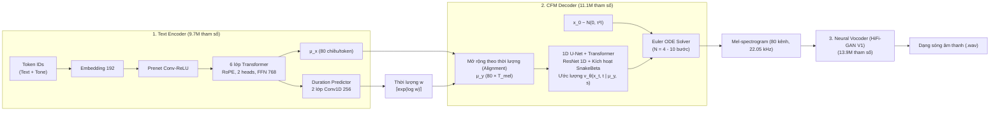

# Tài Liệu 2: Cơ Sở Toán Học & Kiến Trúc Mô Hình Matcha-TTS

> **Thứ tự đọc:** `2 / 5` — Đọc tài liệu này để hiểu bản chất toán học của Optimal-Transport Conditional Flow Matching (OT-CFM), các phương trình vi phân và chi tiết từng khối mạng nơ-ron trong mô hình.

---

## 1. Cơ Sở Toán Học: Optimal-Transport Conditional Flow Matching (OT-CFM)

### 1.1. Từ Diffusion đến Flow Matching
Các mô hình sinh dựa trên phân phối xác suất truyền thống (như Score-based Diffusion / Grad-TTS) sử dụng phương trình vi phân ngẫu nhiên (SDE) để biến nhiễu trắng thành dữ liệu. Tuy nhiên, quỹ đạo khuếch tán của SDE là **đường cong ngẫu nhiên uốn lượn**, đòi hỏi bộ giải vi phân phải bước từ **50 đến 1000 bước nhỏ** mới đến được phân phối đích, khiến tốc độ suy luận rất chậm.

**Flow Matching** (*Lipman et al., ICLR 2023*) giải quyết bài toán này bằng cách mô hình hóa trực tiếp **trường vector vận tốc tất định** $v_\theta(x, t)$ để đẩy các hạt xác suất dọc theo một phương trình vi phân thường (ODE):
$$\frac{dx_t}{dt} = v_\theta(x_t, t), \qquad t \in [0, 1].$$

### 1.2. Đường vận chuyển tối ưu (Optimal Transport - OT)
Trong bài báo **Matcha-TTS** (*Mehta et al., ICASSP 2024*), tác giả kết hợp Flow Matching với lý thuyết **Vận chuyển tối ưu (Optimal Transport)** để ép đường đi giữa điểm bắt đầu $x_0 \sim \mathcal{N}(0, I)$ (nhiễu Gauss) và điểm đích $x_1$ (mel-spectrogram thật) trở thành **đường thẳng ngắn nhất**:

$$x_t = \psi_t(x_0) = \big(1 - (1 - \sigma_{\min})t\big)x_0 + t x_1,$$

trong đó $\sigma_{\min} = 10^{-4}$ là hằng số nhiễu nhỏ ở biên $t = 1$.

Đạo hàm theo thời gian $t$ cho ta trường vector vận tốc lý tưởng mục tiêu $u_t(x \mid x_1)$:
$$u_t(x \mid x_1) = \frac{x_1 - (1 - \sigma_{\min})x_0}{1} = \frac{x_1 - (1 - \sigma_{\min})x}{1 - (1 - \sigma_{\min})t}.$$

Vì đường truyền là **đường thẳng có vận tốc không đổi**, mô hình không cần phải "uốn lượn" qua nhiều bước giải như Diffusion. Ta chỉ cần **từ 4 đến 10 bước tích phân Euler** là đã có thể tái tạo hoàn hảo phổ mel-spectrogram!

```
Diffusion (Grad-TTS):      x0 (Nhiễu) ──~─~─~─~─~─~─~─> x1 (Mel)  [Quỹ đạo cong, 50-1000 bước]
Flow Matching (Matcha-TTS): x0 (Nhiễu) ─────────────────────> x1 (Mel)  [Đường thẳng OT, 4-10 bước]
```

### 1.3. Hàm mất mát Conditional Flow Matching ($\mathcal{L}_{\text{CFM}}$)
Mạng nơ-ron $v_\theta(x_t, t \mid \mu, s)$ được huấn luyện bằng hàm mất mát hồi quy bình phương tối thiểu (L2) thuần túy để bám sát trường vector mục tiêu $u_t$:

$$\mathcal{L}_{\text{CFM}} = \mathbb{E}_{t \sim \mathcal{U}[0, 1],\, x_0 \sim \mathcal{N}(0, I),\, x_1} \Big\| v_\theta(x_t, t \mid \mu, s) - u_t(x_t \mid x_1) \Big\|^2,$$

trong đó:
- $\mu$ là biểu diễn ngữ cảnh xuất ra từ Text Encoder.
- $s$ là vector nhúng người nói (Speaker Embedding).
- $t$ được lấy mẫu ngẫu nhiên đều trong đoạn $[0, 1]$.

> [!NOTE]
> **Tính ổn định tuyệt đối:** Vì $\mathcal{L}_{\text{CFM}}$ là hàm mất mát hồi quy chuẩn xác (regression), quá trình huấn luyện **hoàn toàn không có Discriminator hay hàm mất mát đối kháng GAN**. Mô hình không bao giờ bị hiện tượng mất ổn định (mode collapse) như VITS.

### 1.4. Quá trình suy luận (Inference qua Euler ODE Solver)
Khi chạy thực tế để tạo giọng nói từ văn bản:
1. Lấy mẫu nhiễu ban đầu $x_0 \sim \mathcal{N}(0, \tau^2 I)$ với $\tau$ là tham số nhiệt độ (`temperature`, mặc định 0.667).
2. Tích phân $N$ bước Euler đều trên đoạn thời gian $[0, 1]$ với bước nhảy $h = 1/N$:
   $$x_{k+1} = x_k + \frac{1}{N} v_\theta\left(x_k, \frac{k}{N} \;\middle|\; \mu, s\right), \qquad k = 0, \dots, N-1.$$
3. Phổ thu được tại bước cuối cùng $x_N$ chính là mel-spectrogram chuẩn xác để đưa vào Vocoder tạo âm thanh.

---

## 2. Kiến Trúc Mạng Nơ-ron Tổng Thể

Kiến trúc Matcha-TTS gồm 3 khối chính được liên kết chặt chẽ:



---

## 3. Chi Tiết Từng Khối Mạng

### 3.1. Text Encoder (Mã hóa văn bản & thanh điệu)
Nhiệm vụ: Chuyển đổi chuỗi token $x_{1:N}$ (đã được tách thanh điệu qua frontend `vi_tone_v2`) thành chuỗi biểu diễn ẩn $\mu_x \in \mathbb{R}^{80 \times N}$:
- **Embedding Layer**: Ánh xạ từng token ID sang vector 192 chiều.
- **Prenet**: Gồm các lớp tích chập 1D kết hợp ReLU và Layer Normalization để trích xuất ngữ cảnh cục bộ.
- **Transformer Blocks (6 lớp)**: 
  - Sử dụng **Rotary Position Embedding (RoPE)** thay cho positional embedding truyền thống. RoPE giúp mô hình ghi nhớ khoảng cách tương đối giữa các token cực tốt, cho phép tổng hợp các câu dài mà không bị vỡ ngữ điệu.
  - Multi-Head Self-Attention: 2 heads, kích thước ẩn 192, feed-forward network (FFN) 768 chiều.
  - Đầu ra là vector trung bình tiên nghiệm $\mu_x$ có số kênh bằng đúng số kênh của mel (80 kênh).

### 3.2. Duration Predictor (Dự đoán thời lượng phát âm)
Nhiệm vụ: Dự đoán mỗi token văn bản sẽ được đọc trong bao nhiêu khung mel-spectrogram (1 khung mel = 256 mẫu âm thanh $\approx 11.6\text{ ms}$):
- Kiến trúc gồm 2 lớp tích chập 1D (kernel size = 3, kênh = 256) kèm Dropout và LayerNorm.
- Dự đoán giá trị thời lượng dạng logarit $\log w_i$. Khi suy luận, thời lượng số khung của token $i$ được tính bằng:
  $$d_i = \left\lceil \exp(\log w_i) \cdot \text{length\_scale} \right\rceil.$$
- Tham số `length_scale` (hay `speaking_rate`) cho phép người dùng điều chỉnh tốc độ đọc nhanh/chậm tùy ý mà không làm méo cao độ giọng.

### 3.3. Monotonic Alignment Search (MAS) viết lại bằng Numba
Trong lúc huấn luyện, ta cần biết chính xác mỗi token ứng với bao nhiêu khung mel của câu audio thật để làm nhãn huấn luyện cho Duration Predictor. 

Thuật toán MAS tìm ma trận căn chỉnh đơn điệu $A^* \in \{0, 1\}^{N \times T}$ sao cho cực đại hóa xác suất log-likelihood Gauss của mel thật $y$ xoay quanh $\mu_x$:
$$A^* = \arg\max_A \sum_{i=1}^N \sum_{j=1}^T A_{ij} \log \mathcal{N}\left(y_j;\, \mu_x^{(i)},\, I\right).$$

* **Bản tối ưu hóa của Dự án (`matcha/utils/monotonic_align/__init__.py`)**:
  Toàn bộ thuật toán quy hoạch động 2D được cài đặt bằng **Numba JIT**:
  ```python
  @numba.njit(parallel=True, cache=True)
  def _maximum_path_batch(paths, values, t_xs, t_ys):
      # Quy hoạch động song song đa lõi cực đại hóa đường đi
      ...
  ```
  Nhờ đó, mã nguồn chạy với tốc độ tương đương C thuần ($O(N \cdot T)$ dưới 2ms cho mỗi câu) nhưng hoàn toàn độc lập với compiler C.

### 3.4. CFM Decoder (1D U-Net với kích hoạt SnakeBeta)
Nhiệm vụ: Dự đoán trường vector vận tốc $v_\theta(x_t, t \mid \mu_y, s)$ để dịch chuyển nhiễu thành mel:
- **Cấu trúc U-Net 1D**: Gồm 2 tầng giảm mẫu (Down-sampling), tầng nút cổ chai (Bottleneck) và 2 tầng tăng mẫu (Up-sampling) với 256 kênh ẩn.
- **Khối tích chập ResNet 1D & Transformer**: Mỗi tầng kết hợp khối dư ResNet với một khối Transformer 2 head.
- **Hàm kích hoạt SnakeBeta**: 
  $$\text{Snake}_\beta(x) = x + \frac{1}{\beta} \sin^2(\beta x).$$
  SnakeBeta có tính tuần hoàn tự nhiên, cực kỳ nhạy cảm với các dao động chu kỳ của sóng âm thanh và thanh điệu, giúp tái tạo đường nét mel-spectrogram sắc cạnh hơn hẳn hàm ReLU hay GELU.
- **Thời gian $t$**: Được nhúng qua bộ mã hóa Sinusoidal Positional Embedding rồi đưa vào mọi tầng mạng của U-Net.

---

## 4. Hàm Mất Mát Tổng Thể (Total Training Loss)

Quá trình huấn luyện Matcha-TTS tối ưu hóa đồng thời 3 mục tiêu bằng hồi quy:

$$\mathcal{L}_{\text{total}} = \mathcal{L}_{\text{dur}} + \mathcal{L}_{\text{prior}} + \mathcal{L}_{\text{CFM}}$$

1. **Duration Loss ($\mathcal{L}_{\text{dur}}$)**: Sai số bình phương giữa thời lượng dự đoán và thời lượng thật do MAS tìm ra:
   $$\mathcal{L}_{\text{dur}} = \sum_{i=1}^N \left( \log w_i - \log d_i \right)^2.$$
2. **Prior Loss ($\mathcal{L}_{\text{prior}}$)**: Ép vector $\mu_x$ của Text Encoder trở thành một bản ước lượng thô của mel-spectrogram thật:
   $$\mathcal{L}_{\text{prior}} = \frac{1}{2} \left\| y - \mu_y \right\|^2.$$
   Nhờ có Prior Loss, CFM Decoder chỉ cần học phần chi tiết tần số cao còn thiếu chứ không cần phải học tạo hình mel từ con số không.
3. **Flow Matching Loss ($\mathcal{L}_{\text{CFM}}$)**: Sai số ước lượng trường vector vận tốc trên đường thẳng OT.

---

## 5. Bảng Tham Số Cấu Hình Chi Tiết (Checkpoint `matcha_vi_v2.pt`)

| Thành phần | Tham số | Giá trị | Ý nghĩa |
| :--- | :--- | :--- | :--- |
| **Âm học** | Sampling Rate ($f_s$) | 22 050 Hz | Tần số lấy mẫu âm thanh |
| | FFT Size / Hop Length | 1024 / 256 | Độ dài cửa sổ FFT và bước nhảy khung (~11.6 ms/khung) |
| | Mel Channels ($n_{\text{feats}}$) | 80 | Số dải tần số mel |
| **Text Encoder** | Token Embedding Size | 192 | Kích thước vector nhúng ký tự & thanh điệu |
| | Encoder Layers | 6 | Số lớp Transformer RoPE |
| | Attention Heads / FFN | 2 / 768 | Cấu hình Attention đa đầu |
| **Duration Predictor** | Filter Channels | 256 | Kênh tích chập dự đoán thời lượng |
| | Kernel Size | 3 | Độ rộng cửa sổ ngữ cảnh |
| **CFM Decoder** | Channels | 256 | Kênh đặc trưng của U-Net 1D |
| | U-Net Blocks | [1, 2, 1] | Số khối tích chập ở các tầng down/mid/up |
| | Activation | SnakeBeta | Hàm kích hoạt tuần hoàn |
| | ODE Solver | Euler | Bộ giải tích phân đường thẳng |
| | Default Timesteps ($N$) | 10 bước | Cân bằng hoàn hảo giữa tốc độ (RTF 0.57) và chất lượng |

---

*Xem tiếp tài liệu kế tiếp để tìm hiểu chi tiết về kỹ thuật thích nghi tiếng Việt: **[`3_thich_nghi_tieng_viet_tone_decoupling.md`](3_thich_nghi_tieng_viet_tone_decoupling.md)**.*
