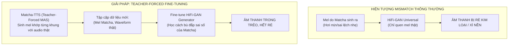

# Tài Liệu 4: Quy Trình Huấn Luyện, Chọn Snapshot ASR & Fine-Tune Vocoder HiFi-GAN

> **Thứ tự đọc:** `4 / 5` — Đọc tài liệu này để nắm vững toàn bộ quy trình thực nghiệm: xử lý tập dữ liệu, chiến lược huấn luyện trên Google Colab, cơ chế chọn lọc snapshot bằng PhoWhisper CER, và kỹ thuật fine-tune Vocoder chống rè kim loại.

---

## 1. Dữ Liệu Huấn Luyện & Tiền Xử Lý Âm Thanh

Dự án đã khảo sát và thực nghiệm trên hai tập dữ liệu tiếng Việt mã nguồn mở phổ biến:

| Đặc tính | Tập dữ liệu VIVOS (ĐH KHTN ĐHQG-HCM) | Tập dữ liệu InfoRe1 (`doof-ferb/infore1_25hours`) |
| :--- | :--- | :--- |
| **Quy mô** | Khoảng 15 giờ (~12.000 câu) | Khoảng 25 giờ (14.935 câu) |
| **Số lượng giọng nói** | 65 người nói (38 nam, 27 nữ) | **1 người nói duy nhất** (giọng nữ miền Bắc) |
| **Mục đích ban đầu** | Huấn luyện nhận dạng giọng nói (ASR) | **Huấn luyện tổng hợp tiếng nói (TTS)** |
| **Môi trường thu âm** | Có tiếng ồn nền, độ ồn đo được $\approx -37\text{ dBFS}$ | Phòng thu sạch, độ ồn đo được $\approx -52\text{ dBFS}$ |
| **Thời lượng/người** | Rất ngắn (khoảng 14 phút/người) | Rất dài (~25 giờ liên tục cùng một giọng) |
| **Ứng dụng trong dự án** | **Phiên bản V1** (`matcha_vi.pt` đa giọng) | **Phiên bản V2** (`matcha_vi_v2.pt` chất lượng cao) |

### Pipeline tiền xử lý âm thanh chuẩn hóa (`src/vivos_preprocessor.py`):
1. **Lấy mẫu lại (Resample)**: Đưa toàn bộ audio về tần số chuẩn $f_s = 22.050\text{ Hz}$.
2. **Cắt khoảng lặng (Trim Silence)**: Sử dụng ngưỡng biên −40 dB để loại bỏ tạp âm tĩnh ở đầu và cuối file ghi âm.
3. **Chuẩn hóa năng lượng (RMS Normalization)**: Đưa mức âm lượng trung bình về $\approx -20\text{ dBFS}$ để tránh hiện tượng câu to câu nhỏ thất thường.
4. **Trích xuất Mel-spectrogram**:
   - $n_{\text{fft}} = 1024$ mẫu.
   - $\text{hop\_length} = 256$ mẫu ($\approx 11.6\text{ ms}$ mỗi khung).
   - $n_{\text{mels}} = 80$ dải tần, dải tần số $f_{\min} = 0\text{ Hz}$, $f_{\max} = 8.000\text{ Hz}$.
   - Chuẩn hóa mel theo giá trị trung bình (`mel_mean`) và độ lệch chuẩn (`mel_std`) tính trên toàn bộ tập dữ liệu.

---

## 2. Chiến Lược Huấn Luyện Trên Google Colab (`notebooks/02_train_matcha_colab.ipynb`)

Mô hình được huấn luyện hoàn chỉnh trên môi trường Google Colab với GPU T4 (16GB VRAM) hoàn toàn miễn phí mà không bị mất dữ liệu khi ngắt kết nối.

### 2.1. Cấu trúc thư mục lưu trữ bền vững trên Google Drive
Toàn bộ trạng thái huấn luyện được đồng bộ tại `MyDrive/Colab Notebooks/TTS/`:
```
MyDrive/Colab Notebooks/TTS/
├── data/         <-- File mel và wav nén (.pt), metadata vocab (tạo 1 lần duy nhất)
├── training/     <-- File checkpoint resume: matcha_v2_resume.pt & hifigan_v2_resume.pt
├── snapshots/    <-- Lưu định kỳ model mỗi 5.000 steps (step_005000.pt, step_010000.pt...)
├── samples/      <-- File audio nghe thử định kỳ để theo dõi trực quan
└── export/       <-- KẾT QUẢ CUỐI: matcha_vi_v2.pt & matcha_vi_v2_hifigan.pt
```

### 2.2. Kỹ thuật Lưu nguyên tử (Atomic Checkpoint) & Tự động phục hồi (Auto-Resume)
Colab miễn phí thường xuyên bị ngắt kết nối đột ngột sau vài giờ. Để đảm bảo không bao giờ bị hỏng file checkpoint:
- Áp dụng hàm `save_atomic()`: Ghi file tạm ra ổ đĩa trước, sau đó mới dùng `shutil.move()` để thay thế file đích. Tránh trường hợp đang ghi file thì bị mất nguồn gây lỗi corrupt file.
- Chu kỳ lưu tự động: Mỗi **15 phút** một lần, mô hình tự động cập nhật trạng thái model, optimizer và gradient scaler vào file resume. Khi phiên Colab mới bật lên, chỉ cần bấm *Run All*, tiến trình sẽ tự động tiếp tục từ đúng step vừa ngắt.

### 2.3. Chuyển giao tri thức (Transfer Learning) từ LJSpeech
Thay vì huấn luyện từ đầu (From Scratch) cần hàng trăm giờ GPU:
- Khởi tạo mô hình từ checkpoint Matcha-TTS tiếng Anh (LJSpeech).
- Tái sử dụng được **302/305 tensor trọng số** (toàn bộ cấu trúc Transformer, U-Net, ResNet và Duration Predictor).
- Chỉ khởi tạo ngẫu nhiên lại lớp Text Embedding (41 token tiếng Việt) và lớp Linear chiếu cuối cùng.
- Nhờ Transfer Learning, mô hình bắt đầu học được ngữ điệu tiếng Việt mượt mà chỉ sau **10.000 steps** đầu tiên.

---

## 3. Chọn Lọc Checkpoint Bằng ASR Objective Metric (VinAI PhoWhisper CER)

### 3.1. Nghịch lý của hàm mất mát Flow Matching
Trong các mô hình CFM, hàm mất mát $\mathcal{L}_{\text{CFM}}$ chững lại rất sớm (sau khoảng 10.000–20.000 steps đồ thị loss đi ngang). Tuy nhiên:
- Loss đi ngang **không có nghĩa là mô hình đã hội tụ xong**.
- Khả năng phát âm tròn vành rõ chữ, ngữ điệu thanh điệu và sự tự nhiên tiếp tục được cải thiện rõ rệt từ step 30.000 đến 100.000 steps!
- Vì vậy, **không thể dùng Validation Loss để dừng sớm hay chọn mô hình tốt nhất**.

### 3.2. Cơ chế tự động chấm điểm bằng PhoWhisper ASR
Tại **Mục 7** của notebook huấn luyện, dự án đã xây dựng quy trình chấm điểm khách quan:
1. Chuẩn bị tập câu đánh giá chuẩn (`EVAL_SENTENCES`) bao gồm đầy đủ các hiện tượng ngữ âm tiếng Việt phức tạp: câu hỏi, từ viết tắt, số liệu, tên riêng.
2. Với mỗi snapshot định kỳ trong thư mục `snapshots/` (`step_*.pt`), mô hình tổng hợp ra các file audio tương ứng.
3. Sử dụng mô hình nhận diện giọng nói tiếng Việt SOTA **VinAI PhoWhisper-base** (`vinai/PhoWhisper-base`) để nghe lại toàn bộ các câu audio này và giải mã thành văn bản nhận dạng.
4. Tính toán tỷ lệ lỗi ký tự (**CER - Character Error Rate**) qua khoảng cách Levenshtein:
   $$\text{CER} = \frac{\text{Khoảng cách chỉnh sửa}(S_{\text{gốc}},\, S_{\text{nhận dạng}})}{\text{Độ dài chuỗi } S_{\text{gốc}}}.$$
5. Snapshot nào đạt **CER thấp nhất** (đọc chuẩn xác và rõ chữ nhất) sẽ được sao chép thành checkpoint chính thức:
   $$\text{snapshots/step\_XXXXXX.pt} \xrightarrow{\quad\text{Lowest CER}\quad} \text{export/matcha\_vi\_v2.pt}.$$

---

## 4. Kỹ Thuật Teacher-Forced Fine-Tuning Vocoder HiFi-GAN

### 4.1. Bản chất vấn đề Lệch phổ (Acoustic-Vocoder Mismatch)
Matcha-TTS là mô hình hai giai đoạn:
$$\text{Văn bản} \xrightarrow{\quad\text{Matcha-TTS}\quad} \text{Mel-spectrogram} \xrightarrow{\quad\text{HiFi-GAN Vocoder}\quad} \text{Dạng sóng âm thanh (Waveform)}.$$
- Bản HiFi-GAN Universal (`hifigan_univ_v1`) được huấn luyện trên mel trích xuất từ audio người thật (độ sắc nét 100%).
- Mel do Matcha-TTS sinh ra là kết quả giải phương trình ODE, mặc dù rất tốt nhưng vẫn có sai số thống kê nhỏ (hơi mịn hơn mel thật).
- Khi đưa mel do Matcha sinh ra vào Vocoder Universal, sự "lệch pha" phân phối này làm Vocoder tạo ra các tần số nhiễu kỳ dị: **tiếng rè kim loại (metallic hiss), âm thanh bị xì và có tiếng sôi nền**.



### 4.2. Quy trình Teacher-Forced Mel Generation
Trong **Mục 8** của notebook:
1. Nạp mô hình Matcha đã chọn ở Mục 7 (`matcha_vi_v2.pt`).
2. Với mỗi câu audio thật trong tập huấn luyện, chạy hàm `teacher_forced_mel()`:
   - Dùng MAS căn chỉnh độ dài token khớp chính xác với số khung mel của audio thật.
   - Chạy CFM Decoder để sinh ra mel tổng hợp nhưng **khớp từng khung thời gian với câu nói thật**.
3. Đóng gói tập dữ liệu gồm hàng nghìn cặp: `{'mel': mel_sinh_ra, 'wav': wav_thật}`.

### 4.3. Kiến trúc mạng đối kháng & Hàm mất mát của HiFi-GAN
Huấn luyện tiếp HiFi-GAN Generator kết hợp với hai bộ phân biệt (Discriminators):
- **Multi-Period Discriminator (MPD)**: Bóc tách âm thanh theo các chu kỳ $p \in [2, 3, 5, 7, 11]$ để nắm bắt các dao động tuần hoàn của dây thanh âm (thanh điệu).
- **Multi-Scale Discriminator (MSD)**: Đánh giá âm thanh ở 3 thang tỷ lệ lấy mẫu khác nhau (nguyên bản, giảm mẫu 2 lần, giảm mẫu 4 lần) để đảm bảo chất âm liền mạch.

Hàm mất mát huấn luyện:
$$\mathcal{L}_G = \mathcal{L}_{\text{mel}} + \mathcal{L}_{\text{feature}} + \mathcal{L}_{\text{adv}}$$
- **Mel Loss ($\mathcal{L}_{\text{mel}}$)**: Sai số L1 giữa mel của sóng âm sinh ra và sóng âm thật (trọng số 45).
- **Feature Matching Loss ($\mathcal{L}_{\text{feature}}$)**: So khớp đặc trưng ở các tầng ẩn của Discriminator.
- **Adversarial Loss ($\mathcal{L}_{\text{adv}}$)**: Đánh lừa Discriminator tin rằng âm thanh sinh ra là âm thanh người thật.

### 4.4. Các giai đoạn hội tụ của Vocoder
- **0 – 2.000 steps (Warmup)**: Discriminator chưa bật, Generator chỉ học bằng Mel Loss để quen dần với phổ mới.
- **2.000 – 10.000 steps (Giai đoạn chuyển tiếp GAN)**: Discriminator bắt đầu phạt mạnh, loss GAN tăng vọt (`g ~ 25`), âm thanh ở giai đoạn này có thể nghe hơi đục hoặc nghẹt.
- **15.000 – 30.000 steps (Hội tụ tối ưu)**: Generator bắt đầu cân bằng với Discriminator, tái tạo đầy đủ các phụ âm gió tần số cao, âm thanh trở nên trong trẻo, tự nhiên và loại bỏ hoàn toàn tiếng rè kim loại.

---

## 5. Xuất Trọng Số & Triển Khai Hệ Thống

Sau khi hoàn tất quá trình huấn luyện, hai file trọng số chuẩn được xuất tại thư mục `export/`:
1. **`matcha_vi_v2.pt`**: Chứa toàn bộ trọng số mạng Matcha-TTS, đã nhúng sẵn metadata bên trong (bộ token 41 ký tự, frontend `vi_tone_v2`, danh sách speaker).
2. **`matcha_vi_v2_hifigan.pt`**: Trọng số Generator của Vocoder HiFi-GAN đã được fine-tune tương ứng.

Người dùng chỉ cần copy 2 file này vào thư mục [text-to-speech_Duy/checkpoints/](file:///d:/Project/vimmrc-qa-voice/text-to-speech_Duy/checkpoints), hệ thống engine [src/matcha_engine.py](file:///d:/Project/vimmrc-qa-voice/text-to-speech_Duy/src/matcha_engine.py) sẽ tự động nạp phiên bản v2 làm mặc định.

---

*Xem tiếp tài liệu kế tiếp để tìm hiểu về mô hình đối chứng VITS: **[`5_mo_hinh_doi_sanh_vits_baseline.md`](5_mo_hinh_doi_sanh_vits_baseline.md)**.*
