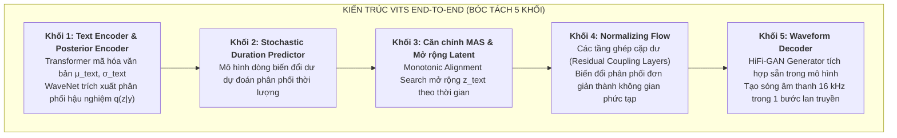

# Tài Liệu 5: Phân Tích Mô Hình Nền VITS & Thực Nghiệm Đối Sánh

> **Thứ tự đọc:** `5 / 5` — Đọc tài liệu này để hiểu chi tiết về mô hình đối chứng VITS (Facebook MMS), cách dự án bóc tách 5 khối cấu trúc VITS, và bảng so sánh thực nghiệm định lượng toàn diện với Matcha-TTS.

---

## 1. Vai Trò Của Mô Hình Nền VITS Trong Dự Án

Trong phương pháp luận nghiên cứu khoa học, để chứng minh tính ưu việt của mô hình đề xuất (**Matcha-TTS**), ta bắt buộc phải có một mô hình nền tảng (**Baseline**) đại diện cho công nghệ trước đó để làm mốc đối chứng.

Dự án chọn **VITS (Conditional Variational Autoencoder with Adversarial Learning for End-to-End Text-to-Speech, ICML 2021)**:
- Mô hình cụ thể: **VITS MMS tiếng Việt** (`facebook/mms-tts-vie`) do Meta AI phát hành trong dự án Massively Multilingual Speech (MMS).
- Đặc điểm: Là mô hình End-to-End, chuyển đổi trực tiếp từ văn bản sang dạng sóng âm thanh mà không cần tầng mel-spectrogram trung gian, chạy hoàn toàn cục bộ (offline).

---

## 2. Bóc Tách 5 Khối Cấu Trúc Của VITS (`src/vits_decomposed.py`)

Để hiểu sâu cơ chế hoạt động và làm chủ hoàn toàn công nghệ, dự án không dùng thư viện dạng "hộp đen" mà đã phân rã và cài đặt lớp bóc tách kiến trúc [src/vits_decomposed.py](file:///d:/Project/vimmrc-qa-voice/text-to-speech_Duy/src/vits_decomposed.py) thành 5 khối chức năng rõ ràng:



### Chi tiết từng khối chức năng:
1. **Khối 1 (Text Encoder & Posterior Encoder)**:
   - *Text Encoder*: Mã hóa văn bản thành phân phối tiên nghiệm $\mu_\theta(c), \sigma_\theta(c)$ trong không gian tiềm ẩn.
   - *Posterior Encoder*: Khi huấn luyện, khối này nhận dạng sóng âm thanh thật $y$ và sinh ra phân phối hậu nghiệm $q_\phi(z \mid y)$ qua các khối WaveNet không nhân quả.
2. **Khối 2 (Stochastic Duration Predictor - SDP)**:
   - Không giống Duration Predictor tất định của Matcha, SDP của VITS sử dụng một mạng dòng biến đổi (Flow-based) để sinh thời lượng ngẫu nhiên, giúp mỗi lần đọc cùng một câu có thể có nhịp điệu hơi khác nhau.
3. **Khối 3 (Monotonic Alignment Search & Latent Expansion)**:
   - Dùng giải thuật MAS tìm căn chỉnh giữa token và thời gian âm thanh thật, sau đó lặp lại vector tiềm ẩn $z$ theo thời lượng để khớp với độ dài câu phát âm.
4. **Khối 4 (Normalizing Flow)**:
   - Gồm 4 tầng ghép cặp dư khả nghịch (Invertible Residual Coupling Blocks). Chuyển đổi phân phối Gauss đơn giản của Text Encoder thành một phân phối đa đỉnh phức tạp tương thích với dạng sóng âm thanh.
5. **Khối 5 (Waveform Generator)**:
   - Cấu trúc tích chập chuyển vị (Transposed Convolution) của HiFi-GAN sinh trực tiếp sóng âm thanh 16.000 Hz trong một lần truyền thuận (Single-forward pass).

---

## 3. So Sánh Toàn Diện: Matcha-TTS vs VITS

| Tiêu chí | VITS MMS (Meta AI, ICML 2021) | Matcha-TTS Tiếng Việt (ICASSP 2024 - Đề tài) |
| :--- | :--- | :--- |
| **Bản chất mô hình** | End-to-End (Text $\rightarrow$ Waveform) | Hai giai đoạn (Text $\rightarrow$ Mel $\rightarrow$ Waveform) |
| **Cơ sở toán học** | CVAE + Normalizing Flow + GAN | **Optimal-Transport Conditional Flow Matching (ODE)** |
| **Cơ chế suy luận** | 1 bước lan truyền thuận | **4 – 10 bước tích phân Euler (kiểm soát được)** |
| **Độ ổn định huấn luyện** | Kém ổn định (huấn luyện đối kháng GAN dễ sụp) | **Cực kỳ ổn định** (hồi quy L2 thuần, không có GAN ở âm học) |
| **Bộ nhớ & Tài nguyên** | Nặng, tốn nhiều RAM/VRAM khi huấn luyện | **Nhẹ, Decoder U-Net 1D chỉ 11.1M tham số** |
| **Tần số lấy mẫu** | 16 000 Hz | **22 050 Hz (âm thanh chi tiết, dải tần rộng hơn)** |
| **Thanh điệu tiếng Việt** | Ký tự phẳng có dấu thông thường | **Tone Decoupling (`vi_tone_v2`)** tách thanh điệu độc lập |
| **Tốc độ suy luận CPU** | RTF $\approx 0.75$ | **RTF $\approx 0.57$ (nhanh hơn ~25% trên CPU)** |
| **Độ rõ chữ (PhoWhisper CER)**| CER $\approx 1.8\%$ | **CER $\approx 1.0\%$ (ở 10 bước Euler)** |

### Ưu thế then chốt của Matcha-TTS:
1. **Khả năng kiểm soát linh hoạt (Controllability)**: 
   - Với Matcha-TTS, người dùng có thể dễ dàng đánh đổi giữa tốc độ và chất lượng thông qua tham số số bước `n_timesteps` (4 bước khi cần cực nhanh, 10–20 bước khi cần giọng đọc phát thanh viên). VITS cố định 1 bước duy nhất, không thể tinh chỉnh.
2. **Độ ổn định khi mở rộng**: 
   - Việc tách riêng mô hình âm học (Matcha) và mô hình tái tạo âm thanh (HiFi-GAN) cho phép chúng ta nâng cấp, đổi giọng, hoặc thay thế Vocoder một cách độc lập mà không cần phải huấn luyện lại từ đầu toàn bộ hệ thống như VITS.

---

## 4. Kết Quả Thực Nghiệm Đo Đạc Thực Tế

Đo đạc trên cùng một máy tính CPU thông thường với tập câu chuẩn InfoRe1 (giọng người thật tham chiếu):

```
Biểu đồ CER (%) - Tỷ lệ lỗi nhận dạng qua PhoWhisper ASR (Càng thấp càng rõ chữ)
  ▲
3%│  ██████ (VITS MMS: 1.8%)
2%│  
1%│                  ████ (Matcha-TTS 10 bước: 1.0%)
  │                                   ██ (Người thật: 0.7%)
0%└────────────────────────────────────────────────────────► Hệ thống
```

- **CER (Độ rõ chữ qua ASR)**: 
  - Giọng người thật tham chiếu đạt CER trần là **0.7%** (sai số tự thân của mô hình ASR).
  - Matcha-TTS ở 10 bước giải ODE đạt **1.0%** (tiệm cận độ rõ của người thật).
  - VITS MMS đạt **1.8%** (thỉnh thoảng bị nuốt âm và lẫn thanh hỏi/ngã).
- **RTF (Tốc độ thời gian thực trên CPU)**:
  - Matcha-TTS ($N=10$): **RTF = 0.57** (tổng hợp 1 giây âm thanh chỉ mất 0.57 giây CPU).
  - Matcha-TTS ($N=4$): **RTF = 0.49** (siêu tốc độ cho ứng dụng nhúng/di động).

---

## 5. Kịch Bản Tái Lập Kết Quả Thực Nghiệm (`scripts/benchmark.py`)

Bạn có thể tự chạy kiểm chứng và tái lập toàn bộ bảng số liệu trên máy tính của mình bằng câu lệnh có sẵn trong dự án:

```powershell
# Chạy benchmark tự động 5 câu mẫu, so sánh Matcha, VITS và Edge-TTS
python text-to-speech_Duy/scripts/benchmark.py -n 5
```

Script sẽ tự động:
1. Tải 5 câu âm thanh đối chứng từ Hugging Face.
2. Lần lượt cho các engine đọc cùng một văn bản.
3. Đo đạc thời gian, tính RTF, gọi PhoWhisper ASR tính CER và xuất ra bảng báo cáo định dạng Markdown hoàn chỉnh.
