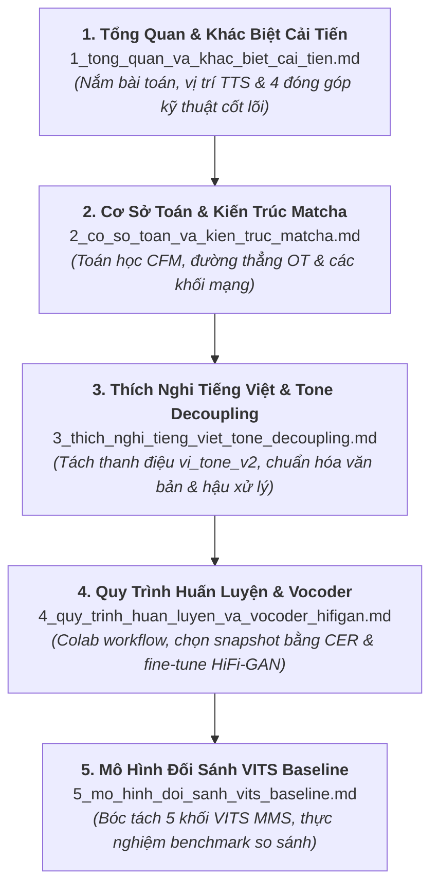

# Hướng Dẫn Đọc Tài Liệu Phân Hệ Text-to-Speech (TTS)

Chào mừng bạn đến với tài liệu kỹ thuật của phân hệ **Text-to-Speech (TTS)** trong dự án **ViMMRC Voice Q&A**.

Toàn bộ tài liệu nghiên cứu, kiến trúc toán học và quy trình thực nghiệm đã được biên soạn và đánh số theo **thứ tự đọc chuẩn từ tổng quan đến chi tiết** (`1_...` đến `5_...`). Bạn hãy đọc lần lượt theo thứ tự dưới đây để nắm bắt trọn vẹn đề tài:

---

## Lộ Trình Đọc Khuyến Nghị

---

## Chi Tiết Từng Tài Liệu

### 📄 [Tài Liệu 1: Tổng Quan Nghiên Cứu, Khác Biệt & Các Điểm Cải Tiến Cốt Lõi](1_tong_quan_va_khac_biet_cai_tien.md)
* **Mục đích**: Hiểu bài toán TTS trong hệ thống Q&A và trả lời câu hỏi phản biện: *"Dự án khác gì các bài báo hiện nay, cải tiến ở điểm nào hay chỉ lấy trên mạng về ghép vào?"*
* **Nội dung chính**:
  - Vị trí của TTS trong pipeline end-to-end (STT $\rightarrow$ Retrieval $\rightarrow$ MRC $\rightarrow$ TTS).
  - Bức tranh công nghệ TTS (FastSpeech 2, VITS, Grad-TTS, Matcha-TTS).
  - **Bốn (04) đóng góp kỹ thuật độc lập**: Tách thanh điệu (Tone Decoupling), MAS bằng Numba JIT, Teacher-Forced Vocoder Fine-Tuning, và chọn checkpoint tự động bằng PhoWhisper CER.
  - Bảng so sánh tổng hợp với bài báo gốc và mô hình Meta MMS.

---

### 📄 [Tài Liệu 2: Cơ Sở Toán Học & Kiến Trúc Mô Hình Matcha-TTS](2_co_so_toan_va_kien_truc_matcha.md)
* **Mục đích**: Hiểu bản chất toán học của Optimal-Transport Conditional Flow Matching (OT-CFM) và cấu trúc mạng nơ-ron.
* **Nội dung chính**:
  - Phương trình vi phân ODE và cơ chế chuyển đổi nhiễu Gauss thành Mel theo đường thẳng OT.
  - Hàm mất mát hồi quy $\mathcal{L}_{\text{CFM}}$ và tính ổn định tuyệt đối (không dùng GAN ở âm học).
  - Chi tiết 3 khối mạng: Text Encoder (Transformer RoPE), Duration Predictor, 1D U-Net Decoder (kích hoạt SnakeBeta).
  - Giải thuật quy hoạch động Monotonic Alignment Search (MAS) viết bằng Numba JIT.

---

### 📄 [Tài Liệu 3: Thích Nghi Tiếng Việt & Đổi Mới Tách Thanh Điệu (Tone Decoupling)](3_thich_nghi_tieng_viet_tone_decoupling.md)
* **Mục đích**: Khám phá giải pháp ngôn ngữ học chuyên sâu xử lý 6 thanh điệu tiếng Việt.
* **Nội dung chính**:
  - Hạn chế của biểu diễn ký tự phẳng `char_v1` (91 token, loãng dữ liệu).
  - Kỹ thuật tách thanh điệu `vi_tone_v2`: Chuẩn hóa Unicode NFD, bóc tách 6 thanh (`0` đến `5`) đặt ở đuôi âm tiết, rút gọn từ vựng còn 41 token.
  - Module chuẩn hóa văn bản hỏi đáp `src/normalizer.py` (nhãn trắc nghiệm, số, ngày tháng, từ viết tắt).
  - Hậu xử lý âm thanh khi suy luận: phân đoạn câu, chèn ngắt nghỉ tự nhiên, cắt nhiễu biên và fade-in/out.

---

### 📄 [Tài Liệu 4: Quy Trình Huấn Luyện, Chọn Snapshot ASR & Fine-Tune Vocoder HiFi-GAN](4_quy_trinh_huan_luyen_va_vocoder_hifigan.md)
* **Mục đích**: Nắm trọn vẹn quy trình huấn luyện thực tế và kỹ thuật xử lý âm học chất lượng cao.
* **Nội dung chính**:
  - Dữ liệu thực nghiệm: VIVOS (15h đa giọng) vs InfoRe1 (25h thu sạch một giọng).
  - Chiến lược huấn luyện trên Google Colab GPU miễn phí: Atomic save, Auto-resume và Transfer Learning từ LJSpeech.
  - Cơ chế tự động chấm điểm snapshot bằng VinAI PhoWhisper CER.
  - Kỹ thuật **Teacher-Forced Fine-Tuning HiFi-GAN Vocoder** để khắc phục hiện tượng lệch phổ Mel và triệt tiêu tiếng rè kim loại.
  - Hướng dẫn đóng gói và triển khai file checkpoint `matcha_vi_v2.pt`.

---

### 📄 [Tài Liệu 5: Phân Tích Mô Hình Nền VITS & Thực Nghiệm Đối Sánh](5_mo_hinh_doi_sanh_vits_baseline.md)
* **Mục đích**: Nghiên cứu mô hình nền tảng VITS MMS dùng làm mốc đối chứng khoa học.
* **Nội dung chính**:
  - Bóc tách kiến trúc 5 khối chức năng của VITS trong `src/vits_decomposed.py`.
  - Bảng so sánh thực nghiệm toàn diện: VITS vs Matcha-TTS về tốc độ RTF, độ rõ CER, dung lượng và tính ổn định.
  - Hướng dẫn chạy kịch bản benchmark tự động `scripts/benchmark.py`.

---

> [!TIP]
> **Tài liệu tham khảo phụ (bản thảo cũ trước khi sắp xếp lại):**
> Các file gốc như `matcha-architecture.md`, `research-plan.md`, `vits-architecture.md` vẫn được lưu trữ song song để đối chiếu lịch sử phát triển của dự án.
