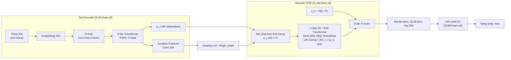

# Kiến Trúc Matcha-TTS: Optimal-Transport Conditional Flow Matching

Tài liệu phân tích cơ sở toán học và cấu trúc của **Matcha-TTS** (Mehta et al., ICASSP 2024), mô hình âm học mặc định của phân hệ TTS. Tài liệu cũng mô tả các phần thích nghi cho tiếng Việt đã cài đặt trong dự án. Mọi tham số nêu dưới đây được đối chiếu với mã nguồn (`Matcha-TTS/matcha/`, `src/`) và checkpoint thực tế.

---

## 1. Bài toán và vị trí của Matcha-TTS

TTS hai giai đoạn ánh xạ chuỗi token văn bản $x_{1:N}$ sang mel-spectrogram $y \in \mathbb{R}^{80 \times T}$ (mô hình âm học), rồi sang dạng sóng (vocoder). Phần khó nằm ở mô hình âm học: ánh xạ **một-nhiều**, vì một câu có vô số cách đọc. Bởi vậy mô hình phải học **phân phối** $p(y \mid x)$ chứ không chỉ học một giá trị trung bình. Nếu chỉ hồi quy L1/L2 như FastSpeech 2, giọng bị "mờ" (oversmoothing).

| Họ mô hình | Cách học $p(y \mid x)$ | Suy luận | Hạn chế |
|---|---|---|---|
| FastSpeech 2 | Hồi quy xác định | 1 bước | Phổ mờ, ngữ điệu đều |
| VITS (ICML 2021) | VAE + Normalizing Flow + GAN, end-to-end | 1 bước | Huấn luyện đối kháng khó ổn định; ràng buộc khả nghịch của flow |
| Grad-TTS (Diffusion) | Score matching, SDE nhiễu | 50–1000 bước | Chậm; quỹ đạo cong cần nhiều bước |
| **Matcha-TTS** | **Conditional Flow Matching, đường OT thẳng** | **4–50 bước ODE** | Hai giai đoạn: chất âm phụ thuộc vocoder |

---

## 2. Cơ sở toán học: Conditional Flow Matching

### 2.1. Luồng xác suất và trường vector

Gọi $p_0 = \mathcal{N}(0, I)$ là phân phối nhiễu và $q(x_1)$ là phân phối dữ liệu (mel đã chuẩn hóa). Một **luồng** $\phi_t$, với $t \in [0, 1]$, được sinh bởi trường vector $v_t$ qua phương trình vi phân thường (ODE):

$$\frac{d}{dt}\phi_t(x) = v_t\big(\phi_t(x)\big), \qquad \phi_0(x) = x.$$

Luồng biến $p_0$ thành đường xác suất $p_t$, và mục tiêu là $p_1 \approx q$. Flow Matching (Lipman et al., ICLR 2023) học trực tiếp trường vector bằng hồi quy:

$$\mathcal{L}_{\text{FM}}(\theta) = \mathbb{E}_{t, x \sim p_t}\,\big\| v_\theta(x, t) - u_t(x) \big\|^2.$$

Mục tiêu này không tính được, vì $u_t$ của đường biên $p_t$ chưa biết.

### 2.2. Điều kiện hóa theo từng mẫu (Conditional FM)

Định lý của Lipman et al.: thay $u_t$ bằng trường vector **có điều kiện** $u_t(x \mid x_1)$ của đường $p_t(x \mid x_1)$ dẫn tới **một** mẫu dữ liệu $x_1$ thì gradient không đổi. Mục tiêu trở nên tính được và **không cần mô phỏng** quỹ đạo khi huấn luyện:

$$\mathcal{L}_{\text{CFM}}(\theta) = \mathbb{E}_{t \sim \mathcal{U}[0,1],\; x_1 \sim q,\; x_0 \sim p_0}\,\big\| v_\theta(\psi_t(x_0), t \mid \mu) - u_t(x_0 \mid x_1) \big\|^2.$$

### 2.3. Đường vận chuyển tối ưu (OT path)

Matcha chọn đường Gauss có kỳ vọng và độ lệch chuẩn tuyến tính theo $t$, ứng với ánh xạ vận chuyển tối ưu (đường thẳng) giữa nhiễu và dữ liệu:

$$\psi_t(x_0) = \big(1 - (1 - \sigma_{\min})\,t\big)\,x_0 + t\,x_1, \qquad u_t = \frac{d\psi_t}{dt} = x_1 - (1 - \sigma_{\min})\,x_0,$$

với $\sigma_{\min} = 10^{-4}$. Trường đích $u_t$ **không phụ thuộc $t$**: mỗi mẫu đi theo một đường thẳng vận tốc không đổi. Đây là lý do suy luận chỉ cần ít bước. Với cùng số bước, sai số tích phân trên quỹ đạo thẳng nhỏ hơn nhiều so với quỹ đạo cong của diffusion.

Cài đặt tương ứng trong `matcha/models/components/flow_matching.py`, hàm `CFM.compute_loss`:

```python
t = torch.rand([b, 1, 1])                               # t ~ U[0, 1]
z = torch.randn_like(x1)                                # x0 ~ N(0, I)
y = (1 - (1 - self.sigma_min) * t) * z + t * x1         # ψ_t(x0)
u = x1 - (1 - self.sigma_min) * z                       # u_t
loss = mse(self.estimator(y, mask, mu, t, spks), u)     # L_CFM, điều kiện μ (đầu ra encoder)
```

### 2.4. Suy luận: giải ODE bằng Euler

Lấy mẫu $x_0 \sim \mathcal{N}(0, \tau^2 I)$, với $\tau$ là `temperature`, mặc định 0.667. Sau đó tích phân $N$ bước Euler đều trên $[0, 1]$:

$$x_{k+1} = x_k + \tfrac{1}{N}\, v_\theta\!\left(x_k, \tfrac{k}{N} \mid \mu\right), \qquad k = 0, \dots, N-1.$$

Chi phí decoder tỉ lệ tuyến tính với $N$, tham số `n_timesteps`. Bài báo gốc dùng 2–10 bước; engine của dự án mặc định $N = 10$ (số đo ở mục 6).

---

## 3. Kiến trúc mạng



| Khối | Cấu hình thực tế (checkpoint `matcha_vi.pt`) |
|---|---|
| Text encoder | Embedding 192, prenet tích chập, 6 lớp Transformer với Rotary Position Embedding (RoPE), 2 head, FFN 768 |
| Duration predictor | 2 lớp tích chập 256 kênh, dự đoán $\log w$ cho mỗi token |
| Decoder (ước lượng $v_\theta$) | U-Net 1D: 2 tầng xuống và 2 tầng lên (256 kênh), 2 khối giữa; mỗi tầng gồm ResNet 1D + 1 khối Transformer 2 head, kích hoạt SnakeBeta; nhúng thời gian $t$ dạng sinusoid |
| Speaker embedding | 64 chiều, 65 người nói VIVOS (checkpoint đa giọng) |
| Bộ giải ODE | Euler, $\sigma_{\min} = 10^{-4}$ |
| Đặc trưng | 80 mel, $f_s$ = 22 050 Hz, FFT 1024, hop 256, $f_{\max}$ = 8 kHz, chuẩn hóa theo mean/std của tập huấn luyện |

### 3.1. Căn chỉnh văn bản và âm thanh: Monotonic Alignment Search

Matcha không cần căn chỉnh ngoài. Khi huấn luyện, MAS (kế thừa từ Glow-TTS/VITS) tìm đường căn chỉnh đơn điệu $A^*$ giữa token và khung mel, sao cho cực đại hóa log-likelihood Gauss của $y$ quanh $\mu_x$, bằng quy hoạch động $O(N \cdot T)$. Thời lượng $d_i = \sum_j A^*_{ij}$ là nhãn cho duration predictor. Dự án thay bản Cython gốc bằng bản **numba** (`scripts/setup_matcha.py`, notebook mục 3) để chạy được trên Colab và Windows mà không cần trình biên dịch.

### 3.2. Hàm mất mát tổng

$$\mathcal{L} = \underbrace{\big\| \log w - \log d \big\|^2}_{\text{duration}} \;+\; \underbrace{\tfrac{1}{2}\big\| y - \mu_y \big\|^2 + \text{const}}_{\text{prior (encoder)}} \;+\; \underbrace{\mathcal{L}_{\text{CFM}}}_{\text{decoder}}.$$

Prior loss buộc $\mu_y$ là xấp xỉ thô của mel, để decoder chỉ phải học phần chi tiết còn lại. Cả ba thành phần đều là hồi quy, **không có huấn luyện đối kháng**, nên ổn định hơn VITS.

---

## 4. Thích nghi cho tiếng Việt

### 4.1. Tách thanh điệu (Tone Decoupling), frontend `vi_tone_v2`

Tiếng Việt có 6 thanh, được viết bằng dấu gắn lên nguyên âm. Nếu dùng ký tự mang dấu làm token (frontend `char_v1` của checkpoint VIVOS), mỗi nguyên âm sinh ra tới 6 token riêng: bộ từ vựng có 91 token và **thanh điệu bị trộn lẫn với âm vị**. Mô hình phải học thanh "huyền" 12 lần, một lần cho mỗi nguyên âm, trên dữ liệu vốn đã ít.

`src/vi_frontend.py` phân tách Unicode (NFD), tách 5 dấu thanh khỏi nguyên âm và đặt thành **một token ở cuối âm tiết**. Thanh ngang được ghi tường minh là `0`. Các dấu tạo nguyên âm (ă, â, ê, ô, ơ, ư) được giữ lại vì chúng là âm vị, không phải thanh điệu.

| Văn bản | `char_v1` | `vi_tone_v2` |
|---|---|---|
| hồ | h · ồ | h · ô · **2** |
| nội | n · ộ · i | n · ô · i · **5** |
| gươm | g · ư · ơ · m | g · ư · ơ · m · **0** |

| Mã | 0 | 1 | 2 | 3 | 4 | 5 |
|---|---|---|---|---|---|---|
| Thanh | ngang | sắc | huyền | hỏi | ngã | nặng |

Kết quả: bộ từ vựng còn **41 token**. Mỗi thanh là một embedding dùng chung cho mọi nguyên âm, nên được học trên toàn bộ dữ liệu. Token thanh đặt ở cuối âm tiết, nơi encoder Transformer có thể dùng nó để điều khiển đường cao độ của cả vần. Frontend cũng đánh vần chữ viết tắt ("B" → "bê"), thay chữ cái ngoại lai (f → ph, …) và tùy chọn giữ dấu câu làm token.

### 4.2. Quy trình huấn luyện (`notebooks/02_train_matcha_colab.ipynb`)

1. **Dữ liệu:** InfoRe1 (khoảng 25 giờ, một giọng nữ, thu sạch) thay cho VIVOS (dữ liệu ASR, 65 giọng, mỗi giọng khoảng 14 phút, nhiễu nền khoảng −37 dB). Audio được resample về 22,05 kHz, cắt im lặng, chuẩn hóa năng lượng RMS khoảng −20 dBFS.
2. **Khởi tạo:** từ checkpoint Matcha LJSpeech. Tái sử dụng 302/305 tensor; chỉ embedding token học lại.
3. **Huấn luyện theo số step** (mặc định 100k), không dừng sớm theo val loss: $\mathcal{L}_{\text{CFM}}$ chững lại sớm trong khi chất giọng vẫn còn cải thiện.
4. **Chọn checkpoint bằng CER:** ASR PhoWhisper nhận dạng lại giọng của từng snapshot.
5. **Fine-tune HiFi-GAN** trên mel *teacher-forced*: mel do decoder sinh ra theo đúng căn chỉnh MAS của câu thật. Cách này giúp vocoder quen với sai lệch của mel tổng hợp và giảm tiếng rè kim loại (vấn đề *mismatch* của hệ hai giai đoạn).

### 4.3. Hậu xử lý khi suy luận (`src/matcha_engine.py`)

- **Ngắt cụm theo dấu câu:** dữ liệu huấn luyện không có dấu câu nên mô hình không tự ngắt nghỉ. Engine sinh từng cụm và chèn khoảng lặng: 0,15 s sau dấu phẩy, 0,25 s sau `;` và `:`, 0,4 s sau dấu kết câu.
- **Cắt nhiễu đầu và cuối cụm** (ngưỡng −30 dB so với đỉnh), fade 10 ms, chuẩn hóa đỉnh −1 dBFS.
- **Chọn giọng:** với checkpoint đa giọng, giọng mặc định là giọng có CER thấp nhất theo giới tính (`scripts/audition_speakers.py`).

---

## 5. So sánh với VITS và Diffusion

| Tiêu chí | VITS | Grad-TTS (Diffusion) | Matcha-TTS |
|---|---|---|---|
| Mô hình xác suất | VAE + Flow khả nghịch | SDE / score matching | ODE / flow matching |
| Hàm mất mát | ELBO + đối kháng + feature matching | Score matching | Hồi quy $\mathcal{L}_{\text{CFM}}$ |
| Quỹ đạo sinh | Không có (1 lần lan truyền) | Cong, ngẫu nhiên | **Thẳng** (OT) |
| Số bước suy luận | 1 | 50–1000 | 4–50 |
| Ổn định khi huấn luyện | Thấp hơn (GAN) | Cao | Cao |
| Bộ nhớ | Cao (phải giải mã cả dạng sóng) | Trung bình | Thấp (decoder 1D nhỏ) |

---

## 6. Đặc tính đo được trên dự án

Đo trên CPU, checkpoint VIVOS, 10 câu InfoRe1 dài 2–8 giây. RTF tính toàn bộ đường xử lý (encoder, ODE, HiFi-GAN, hậu xử lý); CER đo bằng PhoWhisper-base (CER trên chính giọng người thật: 0,7%).

| Số bước $N$ | RTF ↓ | CER ↓ |
|:---:|:---:|:---:|
| 20 | 0,83 | 0,5% |
| **10 (mặc định)** | **0,57** | **1,0%** |
| 4 | 0,49 | 1,6% |

Đây là một lần đo; vì lấy mẫu từ nhiễu ngẫu nhiên, CER dao động giữa các lần chạy (ở 10 bước: 0,8% – 1,9% qua 3 lần). Từ 20 xuống 10 bước, thời gian sinh giảm khoảng 30%, trong khi CER vẫn sát mức trần của ASR. Dưới 10 bước, RTF giảm chậm vì text encoder và vocoder (chạy một lần) chiếm phần lớn thời gian còn lại. Số liệu so với các hệ thống khác ở `README.md`, mục Benchmark.

---

## Tài liệu tham khảo

1. S. Mehta, R. Tu, J. Beskow, É. Székely, G. E. Henter. *Matcha-TTS: A fast TTS architecture with conditional flow matching.* ICASSP 2024. [arXiv:2309.03199](https://arxiv.org/abs/2309.03199)
2. Y. Lipman, R. T. Q. Chen, H. Ben-Hamu, M. Nickel, M. Le. *Flow Matching for Generative Modeling.* ICLR 2023. [arXiv:2210.02747](https://arxiv.org/abs/2210.02747)
3. A. Tong et al. *Improving and generalizing flow-based generative models with minibatch optimal transport.* TMLR 2024. [arXiv:2302.00482](https://arxiv.org/abs/2302.00482)
4. V. Popov et al. *Grad-TTS: A Diffusion Probabilistic Model for Text-to-Speech.* ICML 2021. [arXiv:2105.06337](https://arxiv.org/abs/2105.06337)
5. J. Kim, S. Kim, J. Kong, S. Yoon. *Glow-TTS: A Generative Flow for Text-to-Speech via Monotonic Alignment Search.* NeurIPS 2020. [arXiv:2005.11129](https://arxiv.org/abs/2005.11129)
6. J. Kim, J. Kong, J. Son. *Conditional Variational Autoencoder with Adversarial Learning for End-to-End Text-to-Speech (VITS).* ICML 2021. [arXiv:2106.06103](https://arxiv.org/abs/2106.06103)
7. J. Kong, J. Kim, J. Bae. *HiFi-GAN: Generative Adversarial Networks for Efficient and High Fidelity Speech Synthesis.* NeurIPS 2020. [arXiv:2010.05646](https://arxiv.org/abs/2010.05646)
