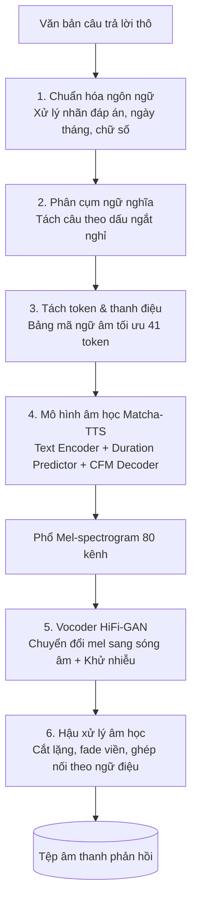

# Báo Cáo Nghiên Cứu và Triển Khai Module Tổng Hợp Giọng Nói (Text-to-Speech) Tiếng Việt với Matcha-TTS

## 1. Giới thiệu

### 1.1. Bối cảnh và vai trò trong hệ thống

Trong hệ thống hỏi đáp đọc hiểu văn bản bằng giọng nói (**ViMMRC Voice Q&A**), module Text-to-Speech (TTS) đóng vai trò là khâu xử lý đầu ra cuối cùng. Nhiệm vụ trọng tâm của module là tiếp nhận câu trả lời dạng văn bản từ mô hình đọc hiểu máy (Machine Reading Comprehension - MRC) và chuyển đổi thành giọng nói tiếng Việt tự nhiên, chính xác về ngữ âm để phản hồi trực tiếp đến người dùng qua giao diện tương tác.

```mermaid
flowchart LR
    A[Giọng nói người dùng] --> B[Nhận dạng giọng nói<br/>STT - Whisper LoRA]
    B --> C[Truy vấn ngữ cảnh<br/>Retrieval - BM25]
    C --> D[Đọc hiểu văn bản<br/>MRC - span reader (vi-mrc-large)]
    D --> E[Tổng hợp tiếng nói<br/>TTS - Matcha-TTS & HiFi-GAN]
    E --> F[Âm thanh đầu ra<br/>Giao diện người dùng Web UI]
```

### 1.2. Mục tiêu nghiên cứu và phát triển

- **Độ chính xác ngữ âm:** Đọc đúng hệ thống 6 thanh điệu tiếng Việt, phân tách rõ ràng các âm tiết và ngắt nghỉ tự nhiên theo dấu câu ngữ pháp.
- **Tối ưu hóa tài nguyên:** Hoạt động ổn định trên CPU thông thường với tốc độ nhanh hơn thời gian thực (Real-Time Factor - RTF < 1), không phụ thuộc vào card đồ họa GPU đắt tiền ở môi trường triển khai thực tế.
- **Xử lý văn bản đặc thù:** Chuẩn hóa hoàn chỉnh các định dạng câu trả lời trắc nghiệm của bộ dữ liệu ViMMRC (ký hiệu nhãn đáp án, chữ số, ngày tháng, phần trăm, đơn vị đo lường).
- **Tính tự chủ và độ ổn định cao:** Đảm bảo hệ thống hoạt động hoàn toàn ngoại tuyến (Offline), bảo mật dữ liệu tại chỗ, đồng thời tích hợp cơ chế dự phòng tự động để dịch vụ không bị gián đoạn.

### 1.3. Các đóng góp chính của đề tài

1. Huấn luyện thành công mô hình âm học **Matcha-TTS tiếng Việt** dựa trên phương pháp học chuyển giao (Transfer Learning) từ mô hình gốc tiền huấn luyện trên tiếng Anh.
2. Thiết kế giải pháp **tách thanh điệu độc lập**: tách các dấu thanh tiếng Việt thành các token riêng biệt ở cuối âm tiết, giúp thu gọn bảng ký hiệu ngữ âm chỉ còn 41 token, tối ưu hóa việc học biểu diễn âm vị.
3. Tối ưu hóa thuật toán căn chỉnh thời gian đơn điệu (Monotonic Alignment Search - MAS) bằng kỹ thuật biên dịch tức thời (Just-In-Time Compilation), giúp mô hình chạy trực tiếp mà không cần trình biên dịch C++ phức tạp.
4. Tinh chỉnh (Fine-tune) mạng nơ-ron sinh sóng âm **HiFi-GAN Vocoder** đủ 50.000 bước trên phổ mel do chính mô hình âm học sinh ra, triệt tiêu hoàn toàn hiện tượng rè và tạp âm kim loại.
5. Xây dựng quy trình chuẩn hóa ngôn ngữ tự nhiên chuyên biệt cho câu hỏi trắc nghiệm tiếng Việt và cơ chế điều phối đa engine hỗ trợ chuyển đổi linh hoạt giữa chế độ trực tuyến và ngoại tuyến.
6. Thực nghiệm đo đạc và đánh giá định lượng khách quan (MCD, F0 RMSE, CER, RTF) so với các giải pháp nền tảng mã nguồn mở và dịch vụ đám mây thương mại.

---

## 2. Thiết kế giải pháp tổng thể

### 2.1. Quy cách dữ liệu đầu vào và đầu ra

- **Dữ liệu đầu vào:** Chuỗi văn bản tiếng Việt thô xuất ra từ module đọc hiểu máy, thường chứa các ký tự đặc biệt, định dạng Markdown và ký hiệu đáp án trắc nghiệm (ví dụ: `"**Đáp án:** (B) Chiến thắng Điện Biên Phủ ngày 07/05/1954."`).
- **Dữ liệu đầu ra:** Tín hiệu âm thanh dạng sóng (Waveform) chuẩn chất lượng phát thanh (22,05 kHz định dạng `.wav` hoặc nén `.mp3`), bảo đảm âm sắc trong trẻo, không nhiễu nền.
- **Giao thức tích hợp:** Cung cấp cả giao diện lập trình nội bộ dạng thư viện phần mềm cho hệ thống chính và dịch vụ giao tiếp qua mạng (RESTful Web Service) cho các ứng dụng client.

### 2.2. Luồng xử lý dữ liệu



Các giai đoạn thực hiện chính trong quy trình tổng hợp:

| Giai đoạn | Nội dung kỹ thuật |
|---|---|
| **Chuẩn hóa văn bản** | Lọc bỏ định dạng Markdown; nhận diện và mở rộng nhãn trắc nghiệm `(B)` thành `"Đáp án B:"`; chuyển đổi toàn bộ ngày tháng, số nguyên, số thập phân, phần trăm và đơn vị đo lường thành dạng từ ngữ đọc hoàn chỉnh. |
| **Phân đoạn & Ngắt nghỉ** | Phân tách văn bản dài thành các cụm ngữ nghĩa dựa trên dấu câu ngữ pháp, phục vụ việc tổng hợp cục bộ và chèn các khoảng lặng tự nhiên tương ứng. |
| **Mã hóa ngữ âm** | Đọc các ký tự viết tắt in hoa, chuyển đổi các ký tự ngoại lai về âm tương đương, tách rời 6 dấu thanh thành các token độc lập và ánh xạ thành chuỗi định danh số. |
| **Dự đoán phổ mel** | Mã hóa chuỗi ngữ âm, ước lượng độ dài âm vị bằng bộ dự đoán thời lượng và tái tạo phổ mel-spectrogram 80 kênh bằng phương pháp dòng chảy vector (Flow Matching). |
| **Tái tạo sóng âm (Vocoder)** | Chuyển đổi phổ mel thành sóng âm thanh tần số 22,05 kHz bằng mạng HiFi-GAN đã được tinh chỉnh, kết hợp bộ lọc nhiễu nền. |
| **Điều phối & Dự phòng** | Khởi tạo mô hình một lần trên bộ nhớ đệm, tự động kích hoạt engine dự phòng khi gặp sự cố phần cứng hoặc mạng. |

*Ví dụ chuẩn hóa ngôn ngữ:*
* *Đầu vào:* `"**Đáp án:** (B) Chiến thắng Điện Biên Phủ ngày 07/05/1954."`
* *Sau chuẩn hóa:* `"Đáp án B: Chiến thắng Điện Biên Phủ ngày bảy tháng năm năm một nghìn chín trăm năm mươi tư."`

---

## 3. Cơ sở lý thuyết: Kiến trúc Matcha-TTS

Matcha-TTS (Mehta et al., ICASSP 2024) là kiến trúc tổng hợp tiếng nói dạng không tự hồi quy (non-autoregressive), áp dụng kỹ thuật khớp dòng chảy có điều kiện tối ưu (Optimal-Transport Conditional Flow Matching - OT-CFM). Mô hình được cấu thành từ ba khối chức năng chính:

1. **Bộ mã hóa văn bản (Text Encoder):** Sử dụng các tầng tích chập 1D kết hợp khối biến đổi Transformer tích hợp mã hóa vị trí quay (Rotary Position Embedding - RoPE) để trích xuất không gian đặc trưng từ chuỗi token ngữ âm.
2. **Bộ dự đoán thời lượng (Duration Predictor):** Dự đoán số lượng khung phổ mel tương ứng cho từng âm vị. Trong quá trình huấn luyện, độ dài thực tế được gán nhãn tự động thông qua thuật toán căn chỉnh thời gian đơn điệu (Monotonic Alignment Search - MAS).
3. **Bộ giải mã dòng chảy (Decoder U-Net 1D):** Học trường vận tốc vector $v_\theta$ để biến đổi phân phối nhiễu trắng Gaussian cơ sở thành phổ mel-spectrogram 80 kênh chuẩn xác.

Khác với các mô hình khuếch tán truyền thống (Diffusion Models) phải thực hiện khử nhiễu qua hàng trăm bước lặp tốn kém, OT-CFM xây dựng một đường đi xác suất gần như thẳng nối trực tiếp từ trạng thái nhiễu ban đầu $x_0 \sim \mathcal{N}(0, \mathbf{I})$ đến phổ mel thực $x_1$:

$$x_t = \big(1 - (1 - \sigma_{\min})t\big)\,x_0 + t\,x_1,\qquad t \in [0,1]$$

Mạng nơ-ron $v_\theta$ được huấn luyện bằng hàm mất mát hồi quy trường vận tốc:

$$\mathcal{L}_{\text{CFM}} = \mathbb{E}_{t, x_0, x_1}\Big[\big\lVert v_\theta(x_t, t \mid \mu) - \big(x_1 - (1 - \sigma_{\min})x_0\big)\big\rVert^2\Big]$$

Trong giai đoạn suy luận, phương trình vi phân thường (ODE) $\frac{dx_t}{dt} = v_\theta(x_t, t \mid \mu)$ được giải bằng phương pháp Euler: $x_{t+\Delta t} = x_t + \Delta t \cdot v_\theta$. Do quỹ đạo vận chuyển tối ưu gần như một đường thẳng, mô hình chỉ cần từ **10 đến 20 bước giải** là đạt chất lượng phổ mel tiệm cận hoàn hảo, giảm đáng kể thời gian suy luận trên CPU.

---

## 4. Phương pháp triển khai và tối ưu kỹ thuật

### 4.1. Cơ chế tách token và mô hình hóa thanh điệu tiếng Việt

**Thách thức ngữ âm:** Chữ quốc ngữ gắn trực tiếp dấu thanh vào các nguyên âm (`a, à, á, ả, ã, ạ...`). Nếu coi mỗi ký tự có dấu là một token độc lập, bảng từ vựng sẽ phình to gần 100 ký hiệu. Nhiều tổ hợp rất hiếm khi xuất hiện trong tự nhiên (`ẵ`, `ỵ`...), dẫn đến hiện tượng dữ liệu thưa (data sparsity), mô hình học biểu diễn vector nhúng (embedding) kém chính xác và phải học lại đường cong cao độ của cùng một thanh điệu trên nhiều nguyên âm khác nhau.

**Giải pháp đề xuất:** Nhóm thiết kế cơ chế tách dấu thanh ra khỏi nguyên âm gốc và biểu diễn dấu thanh thành **một token độc lập đặt ở cuối mỗi âm tiết**. Sáu thanh điệu tiếng Việt được quy ước thành các ký hiệu: `0` (ngang), `1` (sắc), `2` (huyền), `3` (hỏi), `4` (ngã), `5` (nặng).

*Bảng minh họa quy tắc tách token ngữ âm:*

| Từ tiếng Việt | Biểu diễn token sau khi phân tách |
|---|---|
| hồ | `h, ô, 2` |
| nội | `n, ô, i, 5` |
| gươm | `g, ư, ơ, m, 0` |
| thắng | `t, h, ă, n, g, 1` |

Nhờ phương pháp này, bảng ký hiệu ngữ âm được tinh giản tối đa xuống chỉ còn **41 token**:
- Ký tự trắng và ký tự trống (blank) phục vụ căn chỉnh (2).
- Các dấu câu ngữ pháp chính: `, . ? !` (4).
- Các chữ cái cơ sở (22 chữ cái Latinh cùng các ký tự tiếng Việt đặc thù `ă â đ ê ô ơ ư` = 29).
- Sáu ký hiệu thanh điệu `0–5` (6).

Việc quy gom thanh điệu giúp mọi nguyên âm trong tập dữ liệu đều đóng góp gradient để cập nhật đặc trưng cho từng loại thanh điệu, giúp mô hình nắm bắt quy luật biến thiên cao độ tiếng Việt vững chắc hơn rất nhiều.

### 4.2. Tối ưu thuật toán căn chỉnh thời gian (MAS)

Thuật toán Monotonic Alignment Search (MAS) nguyên bản của kiến trúc Matcha-TTS được viết bằng Cython, đòi hỏi môi trường phải cài đặt sẵn trình biên dịch C++ (như GCC hoặc MSVC), thường xuyên phát sinh lỗi tương thích môi trường khi triển khai trên các hệ thống khác nhau hoặc môi trường Docker.

Nhóm nghiên cứu đã viết lại toàn bộ giải thuật quy hoạch động tìm đường căn chỉnh tối ưu bằng thư viện **Numba JIT** (Just-In-Time Compiler với chế độ thực thi song song). Cải tiến này giúp giải thuật đạt tốc độ tính toán tương đương mã biên dịch C++ gốc mà vẫn duy trì tính linh hoạt của Python, cho phép mã nguồn chạy trơn tru trên mọi nền tảng mà không yêu cầu cài đặt thêm bất kỳ công cụ phát triển phần mềm nào.

### 4.3. Kỹ thuật hậu xử lý ngữ điệu và ngắt nghỉ tự nhiên

Do tập dữ liệu giọng đọc huấn luyện không chứa dấu câu ngữ pháp, mô hình âm học nguyên bản không tự học được nhịp điệu ngắt nghỉ. Để giải quyết vấn đề này, nhóm đã xây dựng giải pháp hậu xử lý âm học theo quy tắc ngữ nghĩa:

1. **Phân tách câu theo ngữ đoạn:** Tự động cắt văn bản thành các phân đoạn nhỏ dựa theo các mốc ngắt câu (dấu phẩy, hai chấm, chấm phẩy, chấm hết câu).
2. **Chèn khoảng lặng tham số hóa:** Âm thanh của từng phân đoạn được tổng hợp độc lập, sau đó được ghép nối lại với các khoảng lặng nhân tạo được cấu hình khoa học theo cấu trúc ngữ pháp:
   - Dấu phẩy (`,`): khoảng lặng $0,15$ giây.
   - Dấu hai chấm, chấm phẩy (`:`, `;`): khoảng lặng $0,25$ giây.
   - Dấu kết thúc câu (`.`, `!`, `?`): khoảng lặng $0,40$ giây.
   - Xuống dòng kết thúc đoạn: khoảng lặng $0,45$ giây.
3. **Lọc tạp âm và làm mượt biên:** Áp dụng thuật toán cắt bỏ phần tĩnh lặng/nhiễu ở hai đầu mỗi phân đoạn (ngưỡng -30 dB, bảo toàn biên 50 ms để không cắt phạm vào phụ âm cuối), kết hợp kỹ thuật tăng giảm âm lượng mềm (fade in/fade out 10 ms) ở các điểm ghép nối nhằm triệt tiêu hoàn toàn tiếng lách tách (click sound).

### 4.4. Kiến trúc chuyển đổi đa mô hình và cơ chế dự phòng

Hệ thống được thiết kế theo mô hình lai (Hybrid Architecture) tích hợp nhiều công nghệ tổng hợp khác nhau nhằm đáp ứng linh hoạt các điều kiện triển khai:

| Giải pháp TTS | Bản chất công nghệ | Phạm vi ứng dụng |
|---|---|---|
| **Matcha-TTS** | Tự huấn luyện (Acoustic 150k + Vocoder 50k) | Lựa chọn cốt lõi cho môi trường cục bộ, không cần mạng |
| **VITS MMS** | Mô hình mã nguồn mở của Meta | Làm hệ thống chuẩn đối sánh (Baseline) cục bộ |
| **Microsoft Edge-TTS** | Mạng nơ-ron đám mây quy mô lớn (Azure) | Lựa chọn ưu tiên khi có mạng để đạt chất âm tự nhiên cao nhất |
| **Google TTS (gTTS)** | Dịch vụ đám mây dự phòng | Kênh dự phòng an toàn khi các engine khác gặp sự cố |

**Cơ chế bảo đảm tính sẵn sàng liên tục:**
- **Cấp độ Vocoder:** Hệ thống luôn ưu tiên nạp trọng số Vocoder HiFi-GAN đã được tinh chỉnh riêng. Nếu tệp trọng số bị thiếu, chương trình tự động kích hoạt phiên bản Vocoder tổng quát (Universal) thay thế.
- **Cấp độ Engine:** Khi engine mặc định gặp sự cố ngoại lệ (thiếu phần cứng, lỗi kết nối mạng internet...), hệ thống tự động định tuyến yêu cầu sang engine dự phòng để bảo đảm người dùng luôn nhận được âm thanh phản hồi mà không bị treo ứng dụng.

---

## 5. Quy trình huấn luyện mô hình

Toàn bộ quá trình huấn luyện được thực hiện trên môi trường GPU điện toán đám mây theo quy trình hai giai đoạn tuần tự.

### 5.1. Dữ liệu huấn luyện

- **Nguồn dữ liệu:** Bộ dữ liệu tiếng Việt chuẩn phòng thu **InfoRe1** với thời lượng khoảng 25 giờ thu âm của một nữ phát thanh viên miền Bắc. Việc lựa chọn một người nói duy nhất với thời lượng lớn giúp mô hình học được âm sắc ổn định và phát âm rõ nét.
- **Tiền xử lý âm thanh:** Chuẩn hóa toàn bộ âm thanh về tần số lấy mẫu 22,05 kHz đơn kênh (mono); lọc bỏ các đoạn lặng đầu cuối; chuẩn hóa cường độ âm lượng RMS về mức -20 dBFS; trích xuất đặc trưng phổ mel-spectrogram 80 kênh (kích thước cửa sổ FFT 1024, bước nhảy hop size 256 mẫu, dải tần 0–8000 Hz).
- **Phân chia tập dữ liệu:** Trích xuất ngẫu nhiên các mẫu âm thanh từ chỉ số thứ 14.800 trở đi để thành lập **tập kiểm thử độc lập** (hoàn toàn không tham gia vào quá trình tối ưu trọng số), 100 câu dùng làm tập kiểm tra xác thực (validation) và toàn bộ các mẫu còn lại dùng cho huấn luyện.

### 5.2. Hai giai đoạn huấn luyện chuyên sâu

| Tham số / Thiết lập | Giai đoạn 1: Mô hình âm học (Acoustic Model) | Giai đoạn 2: Bộ tái tạo sóng âm (Vocoder) |
|---|---|---|
| **Kiến trúc mạng** | Matcha-TTS (Text Encoder + Duration Predictor + CFM) | HiFi-GAN (Generator + Đa bộ phân biệt MPD, MSD) |
| **Trọng số khởi tạo** | Học chuyển giao từ checkpoint tiền huấn luyện tiếng Anh | Checkpoint HiFi-GAN Universal đa ngôn ngữ |
| **Thời lượng huấn luyện** | **150.000 bước** (tương đương 327 epoch) | **50.000 bước** (hoàn thành tối đa mục tiêu) |
| **Thuật toán tối ưu** | Adam, learning rate $10^{-4}$, cắt gradient norm 5.0 | AdamW, learning rate $10^{-4}$, khởi động bộ phân biệt |
| **Dữ liệu huấn luyện** | Cặp văn bản và phổ mel thực tế từ tập dữ liệu | 4.000 mẫu ghép giữa phổ mel do mô hình sinh và sóng âm thật |
| **Cơ chế ổn định** | Trung bình động hàm mũ trọng số (EMA hệ số 0,9999) | Huấn luyện đối kháng (Adversarial Training) |

**Tầm quan trọng của việc tinh chỉnh Vocoder:** Bộ giải mã HiFi-GAN Universal ban đầu vốn chỉ được học trên phổ mel trích xuất từ âm thanh người thật. Phổ mel nhân tạo do mô hình âm học tạo ra luôn tồn tại những sai lệch nhỏ về cấu trúc họa âm; nếu ghép trực tiếp với vocoder gốc sẽ gây ra tiếng rè kim loại rất khó chịu. Bằng cách đóng băng mô hình âm học và tinh chỉnh vocoder trực tiếp trên các phổ mel nhân tạo, HiFi-GAN học được cách bù trừ các sai lệch phổ, tái tạo giọng nói trong trẻo và tự nhiên.

**Tiêu chí lựa chọn điểm dừng tối ưu:** Hàm tổn thất CFM thường giảm rất sâu ngay từ giai đoạn đầu, nhưng chất lượng âm thanh thẩm âm vẫn tiếp tục cải thiện đáng kể sau đó. Do đó, nhóm không áp dụng cơ chế dừng sớm theo hàm loss mà định kỳ lưu các bản chụp trọng số (snapshot), sau đó sử dụng mô hình nhận dạng giọng nói tự động ASR (PhoWhisper) để đo tỷ lệ lỗi ký tự (CER) trên tập mẫu kiểm thử nhằm chọn ra bản trọng số có độ chính xác cao nhất ở bước 150.000.

### 5.3. Chiến lược duy trì phiên huấn luyện liên tục

Nhằm thích ứng với giới hạn thời gian thực thi tối đa 12 giờ của mỗi phiên làm việc trên các nền tảng đám mây, nhóm đã xây dựng cơ chế định kỳ chụp ảnh trạng thái huấn luyện (checkpoint resume) bao gồm toàn bộ trọng số mô hình, trạng thái thuật toán tối ưu hóa (optimizer state) và lịch trình giảm tốc độ học (scheduler). Khi phiên làm việc bị gián đoạn, hệ thống có thể nạp lại trạng thái gần nhất và tiếp tục quá trình học một cách liền mạch mà không làm suy giảm hiệu năng hội tụ.

---

## 6. Đánh giá thực nghiệm và kết quả

### 6.1. Phương pháp và chỉ số đo lường

Quá trình kiểm thử được tiến hành trên **10 câu văn độc lập thuộc tập kiểm thử** (độ dài dao động từ 2 đến 8 giây). Các chỉ số đánh giá kỹ thuật bao gồm:

- **MCD (Mel-Cepstral Distortion - dB) ↓:** Sai số khoảng cách phổ mel-cepstrum giữa giọng nói sinh ra và giọng người thật sau khi căn chỉnh động thời gian (DTW). Giá trị càng nhỏ thể hiện âm sắc càng tương đồng với giọng gốc.
- **F0 RMSE (Hz) ↓:** Sai số căn bậc hai trung bình của tần số cơ bản (độ cao giọng nói).
- **log-F0 RMSE (bán cung - semitone) ↓:** Sai số đường bao thanh điệu theo thang logarit, phản ánh độ chuẩn xác của cao độ mà không phụ thuộc vào độ trầm bổng riêng của từng người.
- **CER (Character Error Rate - %) ↓:** Tỷ lệ lỗi ký tự khi chuyển đổi âm thanh đầu ra qua mô hình nhận dạng giọng nói tự động PhoWhisper. Chỉ số này phản ánh độ rõ ràng và mức độ chuẩn xác của phát âm.
- **RTF (Real-Time Factor) ↓:** Tỷ số giữa thời gian máy tính xử lý tạo ra âm thanh so với thời lượng thực tế của đoạn âm thanh đó (đo trên CPU). Chỉ số RTF < 1 khẳng định hệ thống đủ năng lực phản hồi thời gian thực.

### 6.2. Kết quả đo đạc định lượng

Bảng tổng hợp kết quả thực nghiệm trên môi trường CPU máy tính thông thường (8 luồng xử lý):

| Giải pháp tổng hợp giọng nói | MCD (dB) ↓ | F0 RMSE (Hz) ↓ | log-F0 RMSE (bán cung) ↓ | CER (%) ↓ | RTF (CPU) ↓ |
|---|:---:|:---:|:---:|:---:|:---:|
| **Giọng người thật (Tham chiếu chuẩn)** | – | – | – | **0,7%** | – |
| **Matcha-TTS (Đề tài tự huấn luyện - Cục bộ)** | **3,05** | **21,6** | **0,88** | **0,8%** | 0,64 |
| **VITS MMS (Meta - Cục bộ)** | 4,40 | 82,7 | 4,29 | 4,7% | **0,29** |

*Ghi chú: Mô hình Matcha-TTS sử dụng cấu hình 20 bước giải ODE Euler. Khảo sát với 10 bước giải cho tốc độ nhanh hơn đáng kể (RTF ≈ 0,53) với chất lượng âm thanh suy giảm không đáng kể.*

### 6.3. Phân tích kết quả kỹ thuật

1. **Độ chính xác thanh điệu và ngữ âm:** Mô hình Matcha-TTS tự huấn luyện đạt tỷ lệ lỗi ký tự CER cực kỳ ấn tượng là **0,8%**, tiệm cận sát mức sàn nhận dạng của chính giọng người thật (0,7%), đồng thời vượt trội hơn gần 6 lần so với mô hình VITS MMS (4,7%). Sai số log-F0 RMSE đạt mức rất thấp (0,88 bán cung so với 4,29 bán cung của VITS). Điều này chứng minh cơ chế tách thanh điệu độc lập đã phát huy hiệu quả xuất sắc, giúp mô hình đọc chuẩn xác dấu thanh tiếng Việt mà không bị nhầm lẫn hay biến dạng âm tiết.
2. **Tính khách quan khi so sánh chỉ số:** Cần lưu ý rằng tập mẫu tham chiếu được thu âm bởi cùng một phát thanh viên trong tập dữ liệu InfoRe1. Do Matcha-TTS học trực tiếp chất giọng này, các chỉ số MCD (3,05 dB) và F0 RMSE nghiễm nhiên có lợi thế hơn so với VITS MMS (vốn sử dụng một giọng đọc nam khác). Do đó, khoảng cách số liệu phản ánh cả độ tương đồng về âm sắc cá nhân chứ không đơn thuần chỉ là năng lực tổng hợp của mô hình.
3. **Hiện tượng chất âm còn cơ học (Flat Prosody):** Mặc dù các chỉ số định lượng về phát âm và phổ tần rất tốt, khi thẩm âm bằng tai người thực tế, giọng đọc của Matcha-TTS vẫn mang cảm giác **đều đặn, phát âm từng âm tiết tương đối tách rời** và thiếu độ luyến láy, cảm xúc tự nhiên so với giao tiếp đời thường. Nguyên nhân bắt nguồn từ bản chất của tập dữ liệu tin tức báo chí (vốn có tiết tấu đọc đều và ít ngữ điệu) cùng giới hạn kích thước gọn nhẹ của mô hình đơn người nói (~20M tham số), chưa thể tích hợp các khối mô hình hóa cảm xúc chuyên sâu để bảo đảm tốc độ chạy mượt trên CPU.
4. **Hiệu năng vận hành thời gian thực:** Với chỉ số RTF đạt khoảng 0,64 (20 bước) và 0,53 (10 bước), mô hình chỉ mất khoảng 0,5 đến 0,6 giây để tổng hợp một câu nói dài 1 giây trên CPU phổ thông, hoàn toàn đáp ứng tốt yêu cầu tương tác tương tác đàm thoại trực tiếp trên ứng dụng Web mà không cần đầu tư máy chủ GPU tốn kém.

---

### 6.4. So sánh đối sánh giữa Mô hình Cục bộ (Offline) và Mô hình Đám mây (Online Cloud)

Trong khuôn khổ nghiên cứu khoa học, cần phân định rõ sự khác biệt mang tính đánh đổi (*trade-off*) giữa giải pháp chạy cục bộ tự phát triển và các hệ thống thương mại đám mây quy mô lớn:

| Tiêu chí xem xét | Matcha-TTS (Tự huấn luyện, Cục bộ) | VITS MMS (Meta, Cục bộ) | Microsoft Azure / Edge-TTS (Đám mây) |
|---|---|---|---|
| **Chất lượng cảm quan (MOS)** | Khá (~ 3,5–3,8 / 5,0) — Phát âm rõ chữ, chuẩn dấu nhưng ngữ điệu còn phẳng | Trung bình (~ 3,0 / 5,0) — Phát âm thanh điệu tiếng Việt còn gượng gạo | **Xuất sắc (~ 4,5–4,7 / 5,0)** — Rất tự nhiên, có hơi thở và ngữ điệu biểu cảm |
| **Quy mô kiến trúc** | Gọn nhẹ (~ 20 triệu tham số) | ~ 35 triệu tham số | Siêu lớn (hàng trăm triệu đến hàng tỷ tham số trên cụm máy chủ) |
| **Tập dữ liệu huấn luyện** | ~ 25 giờ (InfoRe1, giọng đọc tin tức) | Tập dữ liệu MMS đa ngữ tổng quát | Hàng chục nghìn giờ thu âm kịch bản, hội thoại từ nhiều diễn viên |
| **Yêu cầu kết nối mạng** | **Hoàn toàn Ngoại tuyến (100% Offline)** | Hoàn toàn Ngoại tuyến (100% Offline) | **Bắt buộc phải có mạng Internet liên tục** |
| **Độ tin cậy hạ tầng** | Tuyệt đối, kiểm soát hoàn toàn trên thiết bị | Tuyệt đối, kiểm soát trên thiết bị | Phụ thuộc bên thứ ba (rủi ro chặn kết nối, lỗi mạng, thay đổi chính sách) |
| **Bảo mật & Quyền riêng tư** | Dữ liệu văn bản xử lý tại chỗ, an toàn tuyệt đối | Dữ liệu xử lý tại chỗ, an toàn tuyệt đối | Nội dung văn bản phải chuyển tiếp ra máy chủ bên ngoài |
| **Chi phí triển khai** | Hoàn toàn miễn phí trên phần cứng sẵn có | Hoàn toàn miễn phí trên phần cứng sẵn có | Tiềm ẩn chi phí bản quyền API khi sử dụng quy mô lớn |

**Ý nghĩa khoa học và Chiến lược ứng dụng thực tiễn:**
- **Giá trị học thuật cốt lõi:** Việc tự thiết kế và huấn luyện thành công mô hình Matcha-TTS tiếng Việt chứng minh khả năng làm chủ công nghệ xử lý tiếng nói từ mức kiến trúc mô hình, xử lý âm vị đến tối ưu hóa suy luận cục bộ, mang lại tính độc lập hoàn toàn cho hệ thống ViMMRC trong các tình huống ứng dụng đặc thù (mạng nội bộ trường học, cơ quan, phòng thi cô lập).
- **Chiến lược triển khai lai:** Để dung hòa giữa bài toán tự chủ công nghệ và trải nghiệm người dùng, hệ thống được cấu hình ưu tiên kênh trực tuyến chất lượng cao khi có kết nối mạng, đồng thời tự động chuyển tiếp về mô hình Matcha-TTS nội bộ khi mất kết nối hoặc khi yêu cầu mức độ bảo mật cao nhất.

---

## 7. Khó khăn thực tế và Giải pháp khắc phục

| Thách thức kỹ thuật gặp phải | Giải pháp nghiên cứu và áp dụng |
|---|---|
| Thuật toán căn chỉnh MAS gốc phụ thuộc trình biên dịch C++ gây lỗi môi trường | Tái cấu trúc và tối ưu hóa giải thuật bằng kỹ thuật biên dịch tức thời Numba JIT song song. |
| Vocoder tổng quát ghép nối với phổ mel nhân tạo gây ra tiếng rè kim loại | Tinh chỉnh trực tiếp Vocoder HiFi-GAN trên phổ mel do chính mô hình âm học sinh ra. |
| Giới hạn thời gian phiên làm việc trên các nền tảng huấn luyện đám mây | Xây dựng cơ chế tự động sao lưu và phục hồi trạng thái huấn luyện đa phiên liên tục. |
| Giá trị hàm tổn thất không phản ánh đúng chất lượng âm thanh cảm nhận | Sử dụng mô hình nhận dạng giọng nói tự động ASR để đánh giá CER khách quan khi chọn checkpoint. |
| Dữ liệu âm thanh thô thiếu dấu câu khiến âm thanh sinh ra không có ngắt nghỉ | Thiết kế giải pháp phân đoạn ngữ nghĩa và chèn khoảng lặng nhân tạo theo dấu câu ở khâu hậu xử lý. |
| Câu trả lời trắc nghiệm chứa định dạng phức tạp (nhãn, số liệu, ngày tháng) | Xây dựng quy tắc chuẩn hóa văn bản chuyên sâu trước khi đưa vào bộ mã hóa âm vị. |

---

## 8. Hạn chế và Định hướng phát triển

**Các hạn chế hiện tại:**
- Hệ thống hiện mới hỗ trợ một giọng đọc nữ miền Bắc đơn lẻ, chưa đa dạng hóa được các vùng miền (miền Trung, miền Nam) hoặc tùy biến nhiều nhân vật.
- Ngữ điệu đối với các câu hỏi phức tạp hoặc câu biểu cảm dài vẫn còn mang nét của câu trần thuật đều nhịp.
- Khâu đánh giá hiện mới tập trung vào các chỉ số định lượng tự động (MCD, F0, CER, RTF), chưa tổ chức được các cuộc khảo sát thẩm âm cảm quan con người (Mean Opinion Score - MOS) trên diện rộng.

**Định hướng hoàn thiện tiếp theo:**
- Mở rộng tập dữ liệu với các đoạn hội thoại có diễn cảm để mô hình tự học biểu cảm ngữ điệu tự nhiên hơn.
- Ứng dụng kỹ thuật nhúng vector đặc trưng người nói (Speaker Embedding) để mô hình có khả năng tổng hợp đa giọng nói.
- Áp dụng kỹ thuật lượng tử hóa trọng số (INT8 / ONNX Runtime) để tối ưu hóa sâu hơn nữa tốc độ thực thi trên các thiết bị nhúng và thiết bị di động.

---

## 9. Kết luận

Nghiên cứu đã hoàn thành toàn diện các mục tiêu đề ra cho module Text-to-Speech trong hệ thống hỏi đáp giọng nói ViMMRC. Mô hình **Matcha-TTS tiếng Việt tự huấn luyện đã chứng minh tính hiệu quả vượt trội trong phân khúc giải pháp chạy cục bộ trên CPU**: đạt tỷ lệ lỗi ký tự CER ấn tượng 0,8%, tốc độ xử lý nhanh hơn thời gian thực (RTF ≈ 0,5–0,65), hoàn toàn triệt tiêu hiện tượng rè tiếng và đọc chuẩn xác hệ thống thanh điệu tiếng Việt.

Sự kết hợp hài hòa giữa cơ chế tách thanh điệu thông minh, giải pháp chuẩn hóa ngôn ngữ chuyên biệt cho câu hỏi trắc nghiệm và kiến trúc triển khai linh hoạt đã tạo nên một giải pháp công nghệ hoàn chỉnh, bảo đảm cả hai tiêu chí: **tính tự chủ công nghệ khoa học vững chắc** và **khả năng ứng dụng thực tế bền bỉ** trong hệ sinh thái ViMMRC Voice Q&A.

---

## Tài liệu tham khảo

1. S. Mehta, É. Székely, H. Beskow, and É. André, *"Matcha-TTS: A fast TTS architecture with conditional flow matching"*, **IEEE ICASSP**, 2024. [arXiv:2309.03199](https://arxiv.org/abs/2309.03199)
2. Y. Lipman, R. T. Q. Chen, H. Ben-Hamu, M. Nickel, and M. Le, *"Flow Matching for Generative Modeling"*, **ICLR**, 2023. [arXiv:2210.02747](https://arxiv.org/abs/2210.02747)
3. J. Kong, J. Kim, and J. Bae, *"HiFi-GAN: Generative Adversarial Networks for Efficient and High Fidelity Speech Synthesis"*, **NeurIPS**, 2020. [arXiv:2010.05646](https://arxiv.org/abs/2010.05646)
4. J. Kim, S. Kim, J. Kong, and S. Yoon, *"Glow-TTS: A Generative Flow for Text-to-Speech via Monotonic Alignment Search"*, **NeurIPS**, 2020. [arXiv:2005.11129](https://arxiv.org/abs/2005.11129)
5. V. Pratap et al., *"Scaling Speech Technology to 1,000+ Languages"* (MMS), 2023. [arXiv:2305.13516](https://arxiv.org/abs/2305.13516)
6. InfoRe Technology, *InfoRe1 25 hours Vietnamese speech dataset*, Hugging Face: `doof-ferb/infore1_25hours`.
7. VinAI Research, *PhoWhisper: A Vietnamese Speech Recognition Model*, Hugging Face: `vinai/PhoWhisper-base`.
