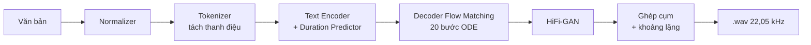

# Text-to-Speech tiếng Việt với Matcha-TTS

Phân hệ cuối của hệ thống ViMMRC Voice Q&A: nhận câu trả lời dạng văn bản và đọc thành giọng nói.
Mục tiêu: giọng đọc **tự nhiên, gần giọng người**, đúng thanh điệu, chạy được trên CPU.

## 1. Luồng xử lý

| Bước | File | Việc làm |
|---|---|---|
| Normalizer | `src/normalizer.py` | Viết số, ngày tháng, đơn vị, tiền tệ thành chữ; chuẩn hóa nhãn đáp án `(B)` → `Đáp án B:` |
| Tokenizer | `src/vi_tokenizer.py` | Tách dấu thanh thành token riêng cuối âm tiết; đánh vần chữ viết tắt (`B` → `bê`) |
| Mô hình âm học | `src/matcha_engine.py` | Matcha-TTS sinh mel-spectrogram |
| Vocoder | `src/matcha_engine.py` | HiFi-GAN đã fine-tune theo mel của chính mô hình |
| Hậu xử lý | `src/matcha_engine.py` | Sinh từng cụm theo dấu câu, chèn lặng 0,15 s (phẩy) / 0,4 s (chấm), fade 10 ms, chuẩn hóa âm lượng |

## 2. Biểu diễn văn bản: tách thanh điệu

Dấu thanh được tách khỏi nguyên âm và đặt thành một token ở cuối âm tiết (0 = ngang, 1 = sắc, 2 = huyền, 3 = hỏi, 4 = ngã, 5 = nặng):

**hồ** → `[h, ô, 2]` &emsp;|&emsp; **nội** → `[n, ô, i, 5]` &emsp;|&emsp; **gươm** → `[g, ư, ơ, m, 0]`

Bộ từ vựng có 41 token: 29 chữ cái, 6 thanh, khoảng trắng, 4 dấu câu và blank. Mỗi thanh là một embedding dùng chung cho mọi nguyên âm, nên được học trên toàn bộ dữ liệu. Token thanh nằm cuối vần giúp self-attention của encoder điều khiển đường cao độ của cả âm tiết.

## 3. Matcha-TTS: Conditional Flow Matching

Encoder cho ra $\mu$ (biểu diễn trung bình của từng khung mel) sau khi duration predictor quyết định độ dài từng token. Decoder học một trường vector $v_\theta$ đưa nhiễu Gauss $x_0$ tới mel thật $x_1$ dọc theo đường thẳng (optimal transport):

$$x_t = (1 - (1-\sigma_{\min})t)\,x_0 + t\,x_1, \qquad \mathcal{L}_{\text{CFM}} = \mathbb{E}_{t,x_0,x_1}\big\lVert v_\theta(x_t, t \mid \mu) - \big(x_1 - (1-\sigma_{\min})x_0\big)\big\rVert^2$$

Khi suy luận, mô hình giải ODE $dx/dt = v_\theta(x, t \mid \mu)$ bằng Euler. Vì quỹ đạo gần thẳng nên chỉ cần ít bước: dùng 20 bước cho giọng mượt, RTF khoảng 0,73 trên CPU; 10 bước nhanh hơn (RTF ~0,55) nhưng hơi kém mịn.

Căn chỉnh văn bản và âm thanh khi huấn luyện dùng Monotonic Alignment Search (MAS), viết bằng numba để chạy được trên Kaggle và Windows mà không cần biên dịch.

## 4. Huấn luyện (`notebooks/train_matcha.ipynb`)

**Dữ liệu:** InfoRe1 (`doof-ferb/infore1_25hours`), khoảng 25 giờ, một giọng nữ thu sạch. Một giọng với nhiều dữ liệu cho giọng mượt và ổn định hơn nhiều giọng mỗi giọng ít dữ liệu. Tiền xử lý: resample 22,05 kHz, cắt lặng hai đầu (40 dB), chuẩn hóa RMS ~ −20 dBFS, mel 80 kênh (FFT 1024, hop 256, 0–8 kHz). Các câu từ chỉ số 14 800 trở đi **không dùng để train** mà để dành làm tập kiểm thử.

**Các bước trong notebook:**

1. Khởi tạo từ checkpoint Matcha LJSpeech (tái sử dụng decoder và phần lớn encoder, chỉ học lại embedding token).
2. Huấn luyện 150k step, Adam lr 1e-4, mixed precision, clip gradient 5. Duy trì **trọng số trung bình trượt (EMA, 0,9999)**: snapshot lưu trọng số EMA, cho giọng ổn định và ít rè hơn trọng số tức thời.
3. Val loss của flow matching chững lại sớm trong khi chất giọng vẫn tốt lên, nên không dừng sớm theo loss. Snapshot (mỗi 10k step) được chấm bằng **CER** qua ASR PhoWhisper; chọn snapshot CER thấp nhất, sau đó nghe lại và có thể chọn thủ công (`CHOSEN_SNAPSHOT`).
4. **Fine-tune HiFi-GAN** 50k step trên cặp (mel do mô hình sinh theo căn chỉnh của câu thật, wav thật), để vocoder quen với mel của mô hình và giảm tiếng rè.
5. Nghe so sánh vocoder Universal và vocoder fine-tune.

**Chạy trên Kaggle:**

- Settings: Accelerator `GPU T4 x2` hoặc `P100`, Internet `ON`.
- **Save Version → Save & Run All (Commit)**: chạy ngầm tối đa khoảng 12 giờ, có thể tắt trình duyệt.
- Kết quả trong Output: `export/matcha_vi.pt`, `export/matcha_vi_hifigan.pt` → chép vào `checkpoints/`. Log: `training_log.csv`, `vocoder_log.csv`, `cer_eval_results.csv`.

### Cách xử lý khi bị ngắt giữa chừng (ví dụ sau 3 tiếng rớt mạng / lỗi / timeout)

Notebook đã được thiết kế cơ chế tự phục hồi: tự động lưu `matcha_resume.pt` mỗi **20 phút** (và vocoder mỗi **30 phút**). Khi bị ngắt, Kaggle **vẫn lưu lại các file đã sinh trong mục Output** của phiên đó. Bạn không cần train lại từ đầu:

1. **Vào lại Notebook** trên Kaggle (chế độ Edit).
2. **Add Checkpoint cũ vào Input:**
   - Bấm nút **+ Add Data** (ở cột bên phải màn hình).
   - Chọn tab **Notebook Output Files** (hoặc *Your Work*).
   - Chọn chính notebook của bạn (phiên vừa bị ngắt sau 3 tiếng) → Bấm nút **+** để thêm vào.
3. **Chạy tiếp:**
   - Bấm **Save Version → Save & Run All** (hoặc Run All).
   - Notebook sẽ tự động quét thấy file `matcha_resume.pt` trong `/kaggle/input/`, tự copy và in `[RESUME] epoch X, step Y`, tiếp tục train từ bước đã lưu mà không tốn công chạy lại 3 tiếng trước.

> [!TIP]
> **Quy trình chia 2 phiên tối ưu (tránh trần 12 giờ của Kaggle):**
> - **Phiên 1 (Train Matcha 150k step):** Nếu bị ngắt giữa chừng thì Add Data `matcha_resume.pt` như trên để chạy tiếp cho đủ 150k step → sinh ra `matcha_vi.pt`.
> - **Phiên 2 (Fine-tune HiFi-GAN 50k step):** Add Data output của Phiên 1 → notebook tự chép dữ liệu, snapshot và `matcha_vi.pt` về, bỏ qua giai đoạn 1 và chạy thẳng vào fine-tune vocoder 50k step → sinh ra `matcha_vi_hifigan.pt`.

Chạy thử nhanh trên CPU ở máy cá nhân: đặt biến môi trường `MATCHA_SMOKE_TEST=1`.

Khi sửa `src/vi_tokenizer.py`, chạy `python scripts/sync_notebook_tokenizer.py` để cập nhật bản sao trong notebook (`tests/test_vi_tokenizer.py` kiểm tra hai bản khớp nhau).

## 5. Tham số ảnh hưởng độ tự nhiên khi suy luận

| Tham số | Mặc định | Ảnh hưởng |
|---|---|---|
| `n_timesteps` | 20 | Nhiều bước hơn thì mel mịn hơn, chậm hơn |
| `temperature` | 0,667 | Thấp: đều, an toàn; cao: biểu cảm hơn nhưng dễ lỗi |
| `rate` | `+0%` | Tốc độ đọc (đổi độ dài dự đoán của duration predictor) |
| Khoảng lặng theo dấu câu | 0,15 / 0,25 / 0,4 s | Dữ liệu train không có dấu câu nên nhịp ngắt được thêm ở bước ghép cụm |

## 6. Đánh giá

`python scripts/benchmark.py` so sánh Matcha-TTS, VITS MMS (`facebook/mms-tts-vie`) và Edge-TTS với **giọng người thật** trên các câu InfoRe1 đã để dành. Báo cáo ghi ra `outputs/benchmark/benchmark_report.md`.

| Chỉ số | Ý nghĩa |
|---|---|
| MCD (dB) ↓ | Sai khác phổ so với giọng thật (gồm cả khác biệt chất giọng) |
| F0 RMSE (Hz) ↓ | Sai số cao độ tuyệt đối |
| log-F0 RMSE (bán cung) ↓ | Hình dạng đường thanh điệu, không phụ thuộc giọng |
| CER ↓ | Độ rõ và độ đúng thanh, đo qua ASR PhoWhisper; dòng "giọng người thật" là mức trần |
| RTF ↓ | Thời gian sinh / thời lượng audio trên CPU |

Các chỉ số tự động chỉ phản ánh một phần độ tự nhiên; nên bổ sung kiểm thử nghe (MOS 1–5) với một nhóm người nghe.

## 7. Tài liệu tham khảo

1. S. Mehta et al., *Matcha-TTS: A fast TTS architecture with conditional flow matching*, ICASSP 2024. [arXiv:2309.03199](https://arxiv.org/abs/2309.03199)
2. Y. Lipman et al., *Flow Matching for Generative Modeling*, ICLR 2023. [arXiv:2210.02747](https://arxiv.org/abs/2210.02747)
3. J. Kong et al., *HiFi-GAN: Generative Adversarial Networks for Efficient and High Fidelity Speech Synthesis*, NeurIPS 2020. [arXiv:2010.05646](https://arxiv.org/abs/2010.05646)
4. J. Kim et al., *Glow-TTS: A Generative Flow for Text-to-Speech via Monotonic Alignment Search*, NeurIPS 2020. [arXiv:2005.11129](https://arxiv.org/abs/2005.11129)
5. V. Pratap et al., *Scaling Speech Technology to 1,000+ Languages* (MMS), 2023. [arXiv:2305.13516](https://arxiv.org/abs/2305.13516)
6. InfoRe Technology, *InfoRe1 25 hours Vietnamese speech*, Hugging Face `doof-ferb/infore1_25hours`.
7. VinAI, *PhoWhisper: Automatic Speech Recognition for Vietnamese*, 2024. Hugging Face `vinai/PhoWhisper-base`.
